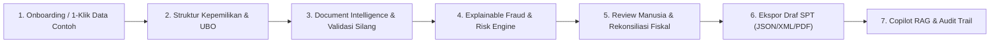

# Nexora v2.0 — Evidence-Based Corporate Tax Compliance & Fiscal Risk Intelligence

> **Value Proposition:** *"Nexora membaca dokumen pajak & korporasi, menandai risiko fraud/kepatuhan lengkap dengan bukti, lalu menyiapkan draf rekonsiliasi fiskal yang siap direview manusia."*

Nexora adalah platform kepatuhan pajak korporasi dan deteksi risiko fiskal berbasis bukti (**Human-in-the-Loop**) yang dirancang untuk **Google Cloud AI Builder Cup — Track 1: Financial Services (BFSI)**.

---

## 1. Masalah & Solusi

### Masalah di Lapangan
Grup usaha multi-entitas (holding dan anak perusahaan lintas yurisdiksi) menghadapi risiko koreksi pajak, sanksi administrasi, dan sengketa audit akibat:
1. **Faktur Pajak Tidak Berdasarkan Transaksi Sebenarnya (TBTS)** atau lawan transaksi dengan NPWP/Tax ID tidak valid.
2. **Ketidaksesuaian Lintas Dokumen** antara Akta Pendirian, Daftar Pemegang Saham (UBO), Laporan Keuangan Audited, dan SPT Tahunan periode sebelumnya.
3. **Biaya Non-Deductible (Pasal 9 UU PPh)** seperti biaya jamuan tanpa daftar nominatif, natura melebihi batas, atau sanksi pajak yang lolos ke perhitungan laba fiskal.
4. **Kertas Kerja Rekonsiliasi Fiskal Manual** yang terpisah dari bukti dokumen sumber dan tidak memiliki jejak audit (*audit trail*).

### Solusi Nexora
Nexora menyatukan ekstraksi dokumen berdampingan (*side-by-side*), validasi silang antar-dokumen, deteksi fraud/risiko *dual-layer* (aturan deterministik + statistik populasi Z-Score/IQR/Benford), kertas kerja rekonsiliasi fiskal interaktif (*What-If Mode*), hingga ekspor draf SPT dan Copilot pajak berbasis sitasi regulasi (*Grounded RAG*).

---

## 2. Alur Utama (Hero Flow)



### Prioritas Cakupan Yurisdiksi (`CountryAdapter`)
- **Indonesia (`ID` — Cakupan Penuh / Full End-to-End):** Validasi NPWP 16 digit / NITKU, e-Faktur PPN, Bukti Potong Unifikasi, Akta & UBO, katalog aturan TBTS/NSFP/Pasal 9 UU PPh/PMK 66/2023/PMK 172/2023, Kertas Kerja Rekonsiliasi Fiskal SPT 1771, serta referensi kode billing (`KAP 411126-100`).
- **Singapura (`SG`), Malaysia (`MY`), Amerika Serikat (`US` — Label `Preview`):** Adapter yurisdiksi modular untuk validasi format identitas pajak (`UEN`, `TIN LHDN`, `EIN IRS`), aturan risiko spesifik (`MISSING_TRADER`, `MYINVOIS_UUID`, `US_TIN_BACKUP_WHT`), serta template ringkasan Form C-S, Form C, dan Form 1120.

---

## 3. Arsitektur Berlapis

```text
+-----------------------------------------------------------------------------------+
| Lapisan UI (Next.js 15 App Router — Bilingual ID/EN, WCAG AA, Stepper Hero Flow)  |
| - Dashboard & 1-Click Sample Loader    - Fraud & Risk Review (Rule + Statistik)   |
| - Ownership Graph & UBO Detector       - Fiscal Reconciliation & What-If Mode     |
| - Side-by-Side Document Intelligence   - Grounded RAG Copilot & Audit Trail       |
+-----------------------------------------+-----------------------------------------+
                                          | HTTP JSON (Header x-nexora-demo / Session)
                                          v
+-----------------------------------------------------------------------------------+
| Lapisan API Routes (Server-Only, Validasi Input Zod, Per-IP Rate Limit, Logger)   |
| - GET  /api/health        - GET/PUT /api/workspace     - POST /api/scan-document  |
| - GET  /api/status        - GET/POST /api/session      - POST /api/copilot        |
+-----------------------------------------+-----------------------------------------+
                                          |
                                          v
+-----------------------------------------------------------------------------------+
| Lapisan Domain & Service Engine (Pure TypeScript + Kontrak Skema Zod)             |
| - ownership.ts (DFS Circular, Total != 100%, Unidentified UBO, High-Risk Conduit) |
| - crossValidation.ts (Akta vs Daftar Pemegang Saham vs LK vs SPT Sebelumnya)      |
| - fraud.ts (Dual-Layer: Rule Score + Statistik Populasi Z-Score / IQR / Benford)  |
| - reconciliation.ts & returns.ts (Kertas Kerja Fiskal, What-If, XML/JSON/PDF)     |
| - rag.ts (Basis Pengetahuan Regulasi Pajak Terkurasi + Anti Prompt-Injection)     |
+-----------------------------------------+-----------------------------------------+
                                          |
                                          v
+-----------------------------------------------------------------------------------+
| Lapisan Adapter (Pluggable Interfaces)                                            |
| 1. AIEngine         : DemoEngine (Deterministik Lokal) | LiveEngine (Gemini API)  |
| 2. CountryAdapter   : IDAdapter (Full) | SGAdapter, MYAdapter, USAdapter (Preview)|
| 3. WorkspaceRepo    : InMemoryWorkspaceRepository | MysqlWorkspaceRepository      |
+-----------------------------------------------------------------------------------+
```

Dokumentasi arsitektur, produk, dan keputusan teknis selengkapnya tersedia di:
- `docs/AUDIT.md` — Audit menyeluruh kondisi awal repositori
- `docs/PRODUCT.md` — Problem statement, persona, JTBD, cakupan, dan non-goals
- `docs/ARCHITECTURE.md` — Kontrak antarmuka, skema data Zod, dan desain adapter
- `docs/DECISIONS.md` — Catatan keputusan arsitektur (ADR)

---

## 4. Variabel Lingkungan (`.env`)

Salin `.env.example` menjadi `.env.local` bila ingin mengaktifkan mode Live Gemini atau database MySQL. **Aplikasi dapat langsung dijalankan dalam Smart Demo Mode tanpa variabel lingkungan apa pun.**

| Variabel | Wajib? | Deskripsi |
| :--- | :---: | :--- |
| `NEXORA_AI_MODE` | Opsional | `'demo'` (default deterministik) atau `'live'` (menggunakan Gemini 2.5 Flash bila `GEMINI_API_KEY` tersedia). |
| `GEMINI_API_KEY` | Opsional | API Key Google Gemini (hanya diakses di server route, tidak pernah diekspos ke client bundle). |
| `MYSQL_URL` | Opsional | Connection string MySQL/Cloud SQL. Jika kosong, otomatis menggunakan `InMemoryWorkspaceRepository`. |
| `NEXORA_ACCESS_TOKEN` | Opsional | Token akses opsional untuk mengaktifkan gerbang login sesi HMAC. |
| `NEXORA_SESSION_SECRET` | Opsional | Secret HMAC SHA-256 untuk penandatanganan cookie sesi. |
| `GOOGLE_CLOUD_PROJECT` | Opsional | ID proyek Google Cloud untuk deployment Cloud Run. |

---

## 5. Cara Menjalankan Secara Lokal

### Prasyarat
- Node.js `>= 20.x`
- npm `>= 10.x`

### A. Menjalankan dalam Smart Demo Mode (Tanpa API Key / Tanpa Database)
```bash
npm ci
npm run dev
```
Buka `http://localhost:3000`, lalu klik tombol **"Coba dengan data contoh (1-Klik)"**.

### B. Menjalankan dalam Live Gemini Mode
```bash
export GEMINI_API_KEY="AIzaSy..."
export NEXORA_AI_MODE="live"
npm run dev
```
Header aplikasi akan otomatis menampilkan badge **`LIVE GEMINI API — Grounded Mode`**. Jika terjadi timeout (>7 detik) atau gangguan jaringan, `LiveEngine` otomatis melakukan *fallback* ke `DemoEngine` tanpa memutus alur pengguna.

### C. Menjalankan Pengujian & Pemeriksaan Kualitas
```bash
npm run lint          # ESLint strict check
npx tsc --noEmit      # TypeScript strict typecheck
npm test              # Unit & API integration tests (Vitest)
npm run build         # Production standalone build
npm run test:e2e      # Playwright E2E smoke test
```

---

## 6. Deployment ke Google Cloud Run & Vercel

### Deploy ke Google Cloud Run (Menggunakan `Dockerfile` Standalone)
```bash
gcloud run deploy nexora-tax-compliance \
  --source . \
  --region asia-southeast2 \
  --platform managed \
  --allow-unauthenticated \
  --port 8080 \
  --set-env-vars="NEXORA_AI_MODE=demo"
```
Verifikasi kesiapan container melalui endpoint health check:
```bash
curl https://<CLOUD_RUN_URL>/api/health
```

### Deploy ke Vercel
Repositori ini terhubung langsung ke Vercel (`https://nexora-chi-cyan.vercel.app`). Setiap push ke branch utama akan membangun ulang bundle Next.js secara otomatis.

---

## 7. Batasan yang Diketahui & Kepatuhan (Non-Goals)

1. **Bukan Nasihat Pajak Resmi:** Seluruh output Nexora adalah alat bantu analisis (*decision-support*) untuk direview oleh konsultan pajak/komite audit. Setiap tarif, pasal, dan posisi fiskal diberi penanda **"Perlu Verifikasi"**.
2. **Tidak Melakukan Pengiriman Resmi (No Official e-Filing):** Ekspor JSON/XML/PDF diberi watermark wajib `"DRAF - BUKAN UNTUK DISAMPAIKAN KE OTORITAS"` dan menggunakan skema kerja internal Nexora.
3. **Transparansi Layanan Cloud:** Analitik statistik (Z-Score, IQR, Hukum Benford) dan ekstraksi dokumen pada mode demo dihitung secara lokal di server Node.js dan diberi label jujur **`"Dihitung lokal (simulasi BigQuery)"`**.

---

## 8. Roadmap Pengembangan

1. **Integrasi Konektor Live Document AI:** Menghubungkan `LiveEngine.extractDocument` ke processor OCR khusus Faktur Pajak & Bukti Potong DJP Coretax.
2. **Sinkronisasi BigQuery & Cloud SQL:** Memindahkan penyimpanan sesi dari `InMemoryWorkspaceRepository` ke Cloud SQL/Firestore terkelola dan mengeksekusi kuartil populasi vendor langsung di BigQuery.
3. **Ekspansi Adapter SG, MY, US ke Status `Full`:** Melengkapi skema validasi XML Peppol InvoiceNow (IRAS) dan MyInvois (LHDN) terhadap spesifikasi publik resmi.
