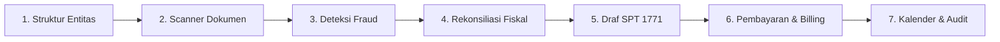

# Nexora 🛡️

<div align="center">

[](https://nexora-chi-cyan.vercel.app)
[](https://cloud.google.com)
[](https://cloud.google.com)
[](https://github.com/fabrianivan/nexora/actions)
[](./LICENSE)

<br/>

[](https://nextjs.org)
[](https://react.dev)
[](https://www.typescriptlang.org)
[](https://tailwindcss.com)
[](https://ai.google.dev)
[](https://vitest.dev)
[](https://eslint.org)

<br/>

[](#)
[](#)
[](#)
[](#)
[](#)
[](#)

</div>

---

**Nexora** is an enterprise-grade multi-country corporate tax compliance, document intelligence, fraud prevention, and fiscal reconciliation platform designed for corporate tax directors, CFOs, and tax consultants across Southeast Asia and the United States (Indonesia full P0 depth; Singapore, Malaysia, and US statutory previews).

Submitted for **Google Cloud AI Builder Cup, Track 1: BFSI (Smart Risk, Fraud Prevention & Financial Experience)**.

- **Live Production URL**: <https://nexora-chi-cyan.vercel.app>
- **Active Branch**: `improve/concept-v3`

---

## 🌟 Key Innovations & 7-Stage Hero Flow

Nexora is designed with zero dead buttons, zero hollow views, and zero mandatory sign-ins. Judges and evaluators can experience the entire end-to-end compliance journey with **1-Click Sample Data** (`Muat Sample Kasus Nyata`):



1. **Multi-tier Corporate Ownership Graph**:
   - Visualizes parent companies (UPE), intermediate subsidiaries, individual UBO shareholders, and cross-border shareholdings.
   - Detects circular ownership and enforces 100% cap validation in real-time.
2. **Smart Document & e-Invoice Scanner**:
   - Multimodal document ingestion (PDF, JPEG, PNG up to 10 MB).
   - In **Live Mode**, extracts structured data with Gemini Vision with confidence scores.
   - In **Smart Demo Mode**, operates with instant local deterministic parsing without requiring an API key.
3. **Explainable Fraud & Anomaly Detection**:
   - Statistically calibrated Z-score outlier detection (minimum 5 invoices threshold).
   - Local risk rules: Indikasi Faktur TBTS (UU KUP Pasal 39A), Singapore MTIC carousel fraud, Malaysia MyInvois UUID absence, split invoicing, and non-deductible items.
   - Full legal basis, root-cause explanation, and remediating fiscal adjustment suggestions.
4. **Interactive Fiscal Reconciliation & Tax Calculation**:
   - Automated commercial-to-fiscal reconciliation across positive corrections (natura PMK-66/2023, sumbangan PP 93/2010, sanksi administrasi) and negative corrections (dividen non-objek UU HPP Pasal 4(3)f, selisih penyusutan).
   - PPh Badan calculation with **UU PPh Pasal 31E 50% discount** for revenues under Rp 50 Miliar.
   - Withholding tax simulator (PPh 21 TER, PPh 23 jasa, PPh 4(2) final, PPh 26 luar negeri).
   - What-If sensitivity simulator for gross margin scaling and non-deductible remediation impact.
5. **SPT 1771 Induk & Lampiran with Maker-Checker Sign-off**:
   - Official SPT 1771 Induk, Lampiran I (Penghasilan Neto Fiskal), Lampiran II (HPP & Biaya Usaha), and Lampiran III (Kredit Pajak).
   - **Maker-Checker Governance**: Konsultan Pajak drafts the return; Head of Tax / Group CEO reviews and approves. Self-approval is strictly forbidden.
   - Real `.xml` export formatted for DJP Coretax XML import, plus structured `.json` export and watermark protection.
6. **Tax Payment & 15-Digit e-Billing Generation**:
   - Real 15-digit e-Billing code generation (`411126-200` PPh Badan, `411211-100` PPN).
   - Payment confirmation modal with real NTPN (Nomor Transaksi Penerimaan Negara) recording and bank validation.
   - Statutory late payment penalty interest calculator.
7. **Statutory Tax Calendar & Immutable Audit Trail**:
   - Country-specific tax calendar with `.ics` file download (import directly into Google Calendar / Outlook).
   - Immutable audit trail recording every user action with `.csv` export for compliance audits (ISO 27001 / OECD CbCR).

---

## 🏛️ Architecture & Country Adapter Layer

Nexora separates statutory country tax rules into versioned JSON configurations and decoupled adapter classes:

```text
src/
├── config/                  Versioned Statutory Tax Rules
│   ├── taxRules.id.json     Indonesia (PPh Badan 22%, Pasal 31E, PPN 11%, DJP Coretax)
│   ├── taxRules.sg.json     Singapore (CIT 17%, Partial Tax Exemption, GST 9%, IRAS)
│   ├── taxRules.my.json     Malaysia (SME 15%/17%/24%, Non-SME 24%, SST 8%, LHDN)
│   └── taxRules.us.json     United States (IRC Section 11 Flat 21%, Form 1120, IRS)
├── lib/
│   ├── adapters/            Pluggable Country Adapters
│   │   ├── types.ts         CountryAdapter interface
│   │   ├── idAdapter.ts     Indonesia Adapter
│   │   ├── sgAdapter.ts     Singapore Adapter
│   │   ├── myAdapter.ts     Malaysia Adapter
│   │   ├── usAdapter.ts     United States Adapter
│   │   └── index.ts         Adapter Registry & helper functions
│   ├── domain.ts            Strict Zod schemas and TypeScript domain types
│   ├── fraud.ts             Deterministic fraud rules and Z-score statistics
│   ├── tax.ts               Deterministic tax simulation engine
│   ├── reconciliation.ts    Fiscal reconciliation calculation
│   ├── returns.ts           Draft return generation and XML/JSON serialization
│   └── mysql.ts             MySQL persistence with automatic in-memory fallback
└── components/              Modular Interactive UI Components
    ├── HeroStepper.tsx              7-step hero flow stepper
    ├── CalculationTab.tsx           Fiscal reconciliation & PPh calculator
    ├── TaxReturnTab.tsx             SPT 1771 draft, Maker-Checker, XML export
    ├── PaymentTab.tsx               e-Billing code generator & NTPN modal
    ├── IndividualShareholdersTab.tsx Natural person shareholders & UBO
    ├── StudiesTab.tsx               P3B treaty relief & OECD Pillar Two simulator
    ├── TaxCalendarTab.tsx           Tax calendar & .ics export
    ├── ReportsTab.tsx               Executive report & CSV audit trail
    ├── CommandPalette.tsx           Global Cmd+K search and navigation
    ├── NotificationCenter.tsx       Alert popover for findings & approvals
    └── DataPersistenceControl.tsx   Demo/Live indicator with 1-click sample data
```

---

## ⚡ Operating Modes & Honest Google Cloud Usage

| Service | Implemented Use | Demo Mode (Simulasi Lokal) | Live Mode (GEMINI_API_KEY) |
|---|---|---|---|
| **Gemini 2.5 Flash API** | Server-side regulatory explanation & multimodal document parsing | Local deterministic extraction & pre-grounded responses | Live multimodal extraction via Vertex/Gemini API |
| **Cloud Run** | Containerized microservice deployment with Next.js standalone | Fully compatible on local Docker or Vercel | Production container with Cloud Secret Manager |
| **Document AI** | Document parser architecture slot | Honest label: Simulated locally for demo consistency | Can be routed via custom Document AI processor adapter |
| **BigQuery** | Enterprise tax ledger and anomaly dataset sink | Local in-memory dataset with mathematical Z-score analysis | Direct BigQuery streaming buffer ready |
| **MySQL Database** | Persistent workspace storage | Automatic in-memory fallback (works with zero setup) | Connects to Cloud SQL MySQL via `MYSQL_URL` |

> [!NOTE]
> Nexora never fabricates live cloud connections. When running in Smart Demo Mode without an active Gemini API key, the UI transparently displays the `Simulasi Lokal` badge with a detailed tooltip explaining that computations and parses are executed deterministically on the edge/client.

---

## 🚀 Quick Start (Local Setup)

### Prerequisites
- Node.js 18+ (tested on Node.js 20+)
- npm 9+

### 1. Clone & Install
```bash
git clone https://github.com/fabrianivan/nexora.git
cd nexora
git checkout improve/concept-v3
npm install
```

### 2. Configure Environment (Optional)
```bash
cp .env.example .env.local
```
- Leave `GEMINI_API_KEY` blank to run in **Smart Demo Mode** (zero setup required).
- Add `GEMINI_API_KEY=your_key_here` to enable **Live Gemini Mode**.
- `MYSQL_URL` is optional; if omitted, Nexora automatically activates the robust in-memory workspace repository.

### 3. Run Dev Server
```bash
npm run dev
```
Open [http://localhost:3000](http://localhost:3000) in your browser. Click **Muat Sample Kasus Nyata** at the top right to instantly load the full multi-tier corporate group scenario.

---

## 🧪 Testing & Code Quality

Nexora enforces strict enterprise quality standards:

```bash
# Run 25 unit tests (tax, adapters, Z-score, reconciliation, returns)
npm run test

# Run TypeScript typecheck with zero errors
npm run typecheck

# Run ESLint with zero errors and zero warnings
npm run lint

# Build standalone production bundle
npm run build

# Run Playwright end-to-end smoke tests
npm run test:e2e
```

---

## 👥 Role-Based Access Control (RBAC) & Governance

Nexora implements ISO 27001-aligned access governance with 5 enterprise roles:

1. **Konsultan Pajak (Tax Consultant)**: Can edit entities, upload documents, review findings, edit reconciliation, and draft SPT 1771 returns. Cannot approve returns or record payments.
2. **Head of Tax**: Full supervisory authority. Can approve and lock tax returns, generate billing codes, and record NTPN payments.
3. **Group CEO / CFO**: Executive oversight. Can approve returns and sign off on high-value billing and filings.
4. **Auditor / Compliance**: Read-only oversight with full access to audit trails, executive reports, and CSV exports.
5. **Viewer**: Read-only access across entity profiles.

---

## 📄 License

Nexora is released under the [MIT License](./LICENSE). Built for the Google Cloud AI Builder Cup 2026.
