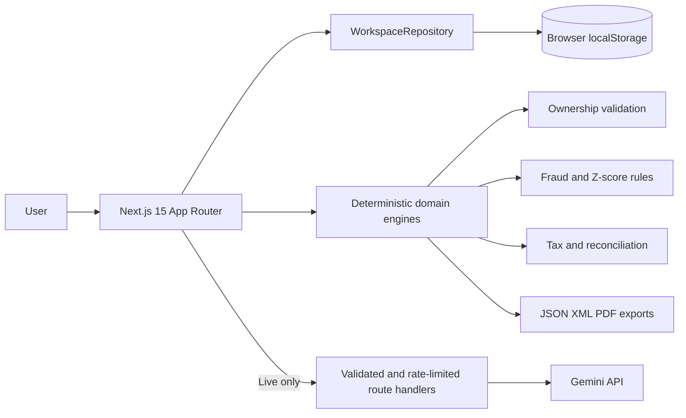

# Nexora 🛡️

<div align="center">

[](https://nexora-chi-cyan.vercel.app)
[](https://cloud.google.com)
[](https://cloud.google.com)
[](https://github.com/fabrianivan/nexora/actions)
[](./LICENSE)

<br/>

[](https://nextjs.org)
[](https://react.dev)
[](https://www.typescriptlang.org)
[](https://tailwindcss.com)
[](https://ai.google.dev)
[](https://vitest.dev)
[](https://eslint.org)

<br/>

[](#)
[](#)
[](#)
[](#)
[](#)
[](#)

</div>

---

Multi-country corporate ownership, document intelligence, fraud detection, and tax compliance workspace for Indonesia, Singapore, Malaysia, and the United States. Built for Google Cloud AI Builder Cup, Track 1: BFSI.

Production: <https://nexora-chi-cyan.vercel.app>

## Capabilities

- Corporate entity CRUD with country-specific Zod validation, ownership graph, 100% ownership checks, and circular ownership detection.
- PDF/JPG/PNG attachment workflow up to 10 MB. Gemini Vision extraction is available only in Live Mode; Manual Mode uses the identical editable schema.
- Local fraud rules for TBTS indicators, IRAS Missing Trader risk, missing MyInvois UUID, split invoicing, non-deductible costs, and Z-score anomalies.
- Deterministic corporate tax, indirect tax, withholding/treaty, and BEPS Pillar Two simulator. Calculations never depend on an LLM.
- Editable fiscal reconciliation and validated draft exports for SPT 1771, Form C-S/Form C, and Form 1120 in JSON/XML plus a printable PDF summary.
- Local browser persistence behind a repository abstraction, with full workspace JSON import/export.

Nexora starts with an empty workspace. It contains no demo companies, fake scans, seeded invoices, or fabricated AI responses.

## Operating Modes

**Manual Mode** is the default when `GEMINI_API_KEY` is absent. Every primary workflow remains available through manual forms. Copilot is disabled with a clear message, and the scanner never invents extracted values.

**Live Mode** is enabled when `GEMINI_API_KEY` is present on the server. Gemini Vision can extract a user-uploaded attachment and Gemini can explain deterministic simulator results. API errors fail closed and return the user to manual entry.

The current implementation calls the Gemini API directly. `DOCUMENT_AI_PROCESSOR_ID`, BigQuery, and Vertex AI settings are optional configuration points and are not claimed as active integrations unless a deployment adds the corresponding adapter.

## Architecture



Business logic lives under `src/lib` and does not rely on AI. API keys remain in server route handlers.

## Run Locally

```bash
npm ci
cp .env.example .env.local
npm run dev
```

Open <http://localhost:3000>. Leave `GEMINI_API_KEY` empty to verify the complete Manual Mode flow.

```bash
npm run lint
npm run test
npm run build
npx playwright install chromium
npm run test:e2e
```

## Project Structure

```text
src/app/                 UI and server route handlers
src/lib/domain.ts        Zod schemas and domain types
src/lib/repository.ts    Swappable workspace repository contract
src/lib/ownership.ts     Graph validation
src/lib/fraud.ts         Local fraud rules and Z-score
src/lib/tax.ts           Deterministic tax simulator
src/lib/reconciliation.ts Fiscal calculations
src/lib/returns.ts       Return schema and serializers
test/                    Vitest unit tests
e2e/                     Playwright smoke test
```

## Security and Data

- Input is validated by Zod; uploads accept only PDF/JPEG/PNG and are capped at 10 MB.
- AI endpoints use an in-memory per-instance rate limit and request timeouts.
- Uploaded bytes are sent to Gemini only after the user explicitly requests extraction. Attachments are not persisted; structured fields and attachment metadata are stored locally in the browser.
- Do not enter production personal data into a shared demo deployment. There is no authentication or server database in this competition build.

## Cloud Run

The standalone Docker image binds to `0.0.0.0` and reads `PORT` (default `8080`).

```bash
docker build -t nexora .
docker run --rm -p 8080:8080 -e PORT=8080 nexora
```

Or deploy with `gcloud run deploy nexora --source . --region asia-southeast2 --allow-unauthenticated` and provide `GEMINI_API_KEY` through Secret Manager/environment configuration for Live Mode.

## Known Limitations

- Browser localStorage is single-device persistence and is not suitable for multi-user production use. Replace `WorkspaceRepository` with Firestore or another authenticated backend.
- Gemini citations are displayed as official regulatory source links; no Vertex AI Search/RAG index is connected in this version.
- Gemini's per-field confidence is model-reported and is not independently calibrated. Missing or invalid extraction output is sent to manual entry; no confidence score is fabricated.
- Risk scores are a UI heuristic based on local findings, not a calibrated probability of fraud. TBTS tax comparisons use a configured standard-rate assumption and require verification against applicable exceptions.
- Z-Score analysis uses e-invoices for each entity separately and requires at least five invoices for that entity.
- The PDF output uses the browser print dialog, not an authority-issued filing form.
- Payment channels are informational only. Nexora does not create billing codes, file returns, or move funds.
- Tax rates are configurable assumptions and require professional review before real filing.
