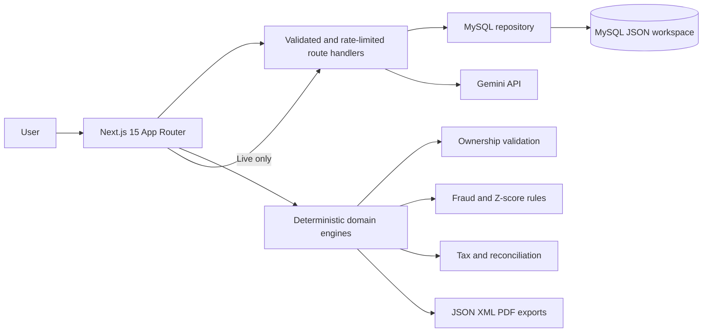

# Nexora 🛡️

<div align="center">

[](https://nexora-chi-cyan.vercel.app)
[](https://cloud.google.com)
[](https://cloud.google.com)
[](https://github.com/fabrianivan/nexora/actions)
[](./LICENSE)

<br/>

[](https://nextjs.org)
[](https://react.dev)
[](https://www.typescriptlang.org)
[](https://tailwindcss.com)
[](https://ai.google.dev)
[](https://vitest.dev)
[](https://eslint.org)

<br/>

[](#)
[](#)
[](#)
[](#)
[](#)
[](#)

</div>

---

Nexora is currently a demo interface for a multi-country corporate tax workspace. It is not a production tax, KYC, fraud, filing, or payments service.

Production: <https://nexora-chi-cyan.vercel.app>

## Current behavior

- The current UI loads synthetic company examples and marks them as demo data. UBO identity fields are redacted.
- Corporate workspace state can be saved to MySQL through the authenticated workspace API. Configure `MYSQL_URL` and the access/session secrets to enable it.
- The document scanner is a simulation. It does not upload or inspect a file, check a government registry, or verify compliance.
- Copilot output is unverified, has no retrieved citations, and must not be used as tax advice. Tax and legal claims: **PERLU VERIFIKASI AHLI PAJAK.**
- The persona switcher changes the demo view only. It is not per-user or per-entity authorization.
- Billing, tax submission, external registry lookups, and payments are not connected.

The application displays a persistent warning that demo scores and sample company data are not production verification.

## Operating Modes

**Development preview** is available without auth configuration, but workspace persistence and AI endpoints remain unavailable. It uses synthetic data only.

In production, configure `NEXORA_ACCESS_TOKEN` and `NEXORA_SESSION_SECRET`. The browser exchanges the access token for an eight-hour, HttpOnly, SameSite session cookie. Workspace, scanner, and Copilot APIs reject requests without a valid session. The access token is shared; configure an identity provider and per-user/tenant authorization before multi-user production use.

When `GEMINI_API_KEY` is configured, Copilot can call Gemini. Its response is still unverified and no search or citation retrieval is connected. Scanner output remains simulated.

## Architecture



Business logic lives under `src/lib` and does not rely on AI. API keys remain in server route handlers.

## Run Locally

```bash
npm ci
cp .env.example .env.local
npm run dev
```

Set `MYSQL_URL`, `NEXORA_ACCESS_TOKEN`, and `NEXORA_SESSION_SECRET` in `.env.local` to enable authenticated persistence. The server creates the `nexora_workspaces` table on first use. In development without auth configuration, the app opens in demo preview and does not save changes. Open <http://localhost:3000>.

```bash
npm run lint
npm run test
npm run build
npx playwright install chromium
npm run test:e2e
```

## Project Structure

```text
src/app/                 UI and server route handlers
src/lib/domain.ts        Zod schemas and domain types
src/lib/mysql.ts         Server-only MySQL workspace repository
src/app/api/workspace/   Validated workspace load/save API
src/lib/ownership.ts     Graph validation
src/lib/fraud.ts         Local fraud rules and Z-score
src/lib/tax.ts           Deterministic tax simulator
src/lib/reconciliation.ts Fiscal calculations
src/lib/returns.ts       Return schema and serializers
test/                    Vitest unit tests
e2e/                     Playwright smoke test
```

## Security and Data

- Workspace, scan simulation, and Copilot endpoints require a signed server session; the access token is shared by all operators.
- Workspace payloads are schema-validated and capped at 5 MB. AI/simulation routes have a basic per-process rate limit.
- The scanner does not accept or inspect file bytes. Do not enter real personal or tax data into the demo.
- There is no user directory, per-user role assignment, tenant isolation, audit log, or row-level ownership. Do not expose real customer data until these controls are implemented.

## Cloud Run

The standalone Docker image binds to `0.0.0.0` and reads `PORT` (default `8080`).

```bash
docker build -t nexora .
docker run --rm -p 8080:8080 -e PORT=8080 nexora
```

Or deploy with `gcloud run deploy nexora --source . --region asia-southeast2 --allow-unauthenticated` and provide `MYSQL_URL`, `NEXORA_ACCESS_TOKEN`, and `NEXORA_SESSION_SECRET` through Secret Manager/environment configuration. The MySQL instance must be reachable from Cloud Run.

## Known Limitations

- Workspace persistence requires MySQL and stores one shared JSON payload; multi-tenant storage is not implemented.
- The demo contains tax rates, compliance scores, ownership, and transaction examples that have not been legally or operationally verified.
- Copilot has no retrieval-backed citations. All tax and legal content: **PERLU VERIFIKASI AHLI PAJAK.**
- No official billing, return submission, registry, KYC/PEP screening, or payment integration exists.
