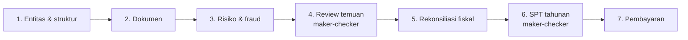

# Nexora 🛡️

<div align="center">

[](https://nexora-chi-cyan.vercel.app)
[](https://cloud.google.com)
[](https://cloud.google.com)
[](https://github.com/fabrianivan/nexora/actions)
[](./LICENSE)

<br/>

[](https://nextjs.org)
[](https://react.dev)
[](https://www.typescriptlang.org)
[](https://tailwindcss.com)
[](https://ai.google.dev)
[](https://vitest.dev)
[](https://eslint.org)

<br/>

[](#)
[](#)
[](#)
[](#)
[](#)
[](#)

</div>

---

**Nexora** is an enterprise-grade multi-country corporate tax compliance, document intelligence, fraud prevention, and fiscal reconciliation platform designed for corporate tax directors, CFOs, and tax consultants across Southeast Asia and the United States (Indonesia full P0 depth; Singapore, Malaysia, and US statutory previews).

Submitted for **Google Cloud AI Builder Cup, Track 1: BFSI (Smart Risk, Fraud Prevention & Financial Experience)**.

- **Live Production URL**: <https://nexora-chi-cyan.vercel.app>
- **Active Branch**: `improve/concept-v3`

---

## 🌟 One connected compliance cycle

Nexora v5 is organised around the 7-step cycle a tax team actually runs. Each step feeds the next, so a fraud finding becomes a fiscal correction, the correction changes the return, and the approved return issues the billing code — no copy-paste between screens. Everything works with sample data and no API key.



| Step | Module | What it does |
|---|---|---|
| — | **Ringkasan** (`/overview`) | Group dashboard: dues ≤ 30 days, open findings, exposure, compliance score per entity, action centre, VAT trend, next deadlines. |
| 1 | **Entitas & struktur** (`/entities`) | Org chart of the group, entity profiles, legal-document checklist with Document AI verification, shareholders/UBO, add subsidiaries, group consolidation & Pillar Two threshold. |
| 2 | **Dokumen** (`/documents`) | Inbox of e-Faktur / invoices / share registers per entity. Upload (PDF/PNG/JPG ≤ 10 MB), AI extraction with per-field confidence, manual override, verification. |
| 3 | **Risiko & fraud** (`/risk`) | Deterministic rule engine over the documents: TBTS, Missing Trader, split invoicing, Z-Score outliers, MyInvois UUID, non-deductible costs, and cross-validation of vendor master data & share registers. Every finding carries evidence, legal basis, money at risk and a suggested fiscal correction. |
| 4 | **Review temuan** (`/review`) | Maker proposes (confirm / dismiss + reason), an independent parent-company checker approves. Confirmed findings push their correction into the reconciliation with one click. Full decision history. |
| 5 | **Rekonsiliasi fiskal** (`/calculation`) | Commercial → fiscal reconciliation per entity, CIT for ID (Pasal 31E), SG (partial exemption), MY (SME tiers), US (21%); tax credits; VAT recap with blocked input VAT; withholding calculator; what-if simulator. |
| 6 | **SPT tahunan** (`/tax-return`) | SPT 1771 / Form C-S / Borang C / Form 1120 generated live from the reconciliation, pre-submission checks, maker-checker approval that locks the figures, XML/JSON export, print. |
| 7 | **Pembayaran** (`/payments`) | All liabilities across jurisdictions, billing codes, NTPN recording, overdue detection and indicative penalties. Approving the return issues the PPh 29 / balance-due billing automatically. |
| | **Kalender**, **Pemegang saham & UBO**, **Laporan & audit**, **Studi & simulator** | Deadlines with .ics export, group-wide UBO register with PII masking & dividend WHT simulator, executive report & append-only audit trail (CSV), treaty / Pillar Two / TP simulators and knowledge library. |

Cross-cutting: **⌘K command palette** (pages, entities, findings, documents), live **notifications**, **RBAC personas** (parent executives see the group; subsidiary staff are scoped to their entity), and the **Tax Copilot** side panel (Gemini when `GEMINI_API_KEY` is set, deterministic fallback otherwise).

---

## 🏛️ Architecture

```text
src/
├── app/                     Next.js App Router — one route per module
│   ├── layout.tsx           Fonts, globals, <Providers>
│   ├── providers.tsx        WorkspaceProvider + UiProvider + AppShell
│   ├── overview/ entities/ entities/[id]/ documents/ risk/ review/
│   ├── calculation/ tax-return/ payments/ calendar/ shareholders/ reports/ studies/
│   └── api/                 bootstrap · sync · reset · status · copilot · scan-document
├── features/                Feature modules (one folder per route)
├── shell/                   Sidebar, top bar, command palette, notifications,
│                            account/RBAC menu, copilot, toasts, cycle status
├── ui/                      Design system: Button, Card, Badge, Field, Dialog, Sheet,
│                            Tabs, Table, Stat, Meter, charts (SVG), Popover …
├── state/                   WorkspaceProvider (single source of truth, DB sync), UI state
├── lib/
│   ├── compliance.ts        Documents → risk engine → maker-checker review → corrections
│   ├── cit.ts               Corporate income tax per jurisdiction
│   ├── fraud.ts             Rule engine & Z-Score (used by compliance.ts)
│   ├── crossValidation.ts   Vendor/share-register consistency checks
│   ├── returns.ts           Return draft + XML serialisation
│   ├── database.ts          SQLite (node:sqlite) / MySQL / memory persistence
│   └── format.ts fx.ts schedule.ts download.ts
└── data/                    Sample group, personas, seed dataset, country configs
```

Persistence: entity, payment, calendar, audit and study tables plus an `app_state` key/value table holding the compliance workspace (`compliance`) and per-entity reconciliations & returns (`ledger`). The database is re-seeded automatically when the sample dataset version changes.

---

## ⚡ Operating Modes & Honest Google Cloud Usage

| Service | Implemented Use | Demo Mode (Simulasi Lokal) | Live Mode (GEMINI_API_KEY) |
|---|---|---|---|
| **Gemini 2.5 Flash API** | Server-side regulatory explanation & multimodal document parsing | Local deterministic extraction & pre-grounded responses | Live multimodal extraction via Vertex/Gemini API |
| **Cloud Run** | Containerized microservice deployment with Next.js standalone | Fully compatible on local Docker or Vercel | Production container with Cloud Secret Manager |
| **Document AI** | Document parser architecture slot | Honest label: Simulated locally for demo consistency | Can be routed via custom Document AI processor adapter |
| **BigQuery** | Enterprise tax ledger and anomaly dataset sink | Local in-memory dataset with mathematical Z-score analysis | Direct BigQuery streaming buffer ready |
| **MySQL Database** | Persistent workspace storage | Automatic in-memory fallback (works with zero setup) | Connects to Cloud SQL MySQL via `MYSQL_URL` |

> [!NOTE]
> Nexora never fabricates live cloud connections. When running in Smart Demo Mode without an active Gemini API key, the UI transparently displays the `Simulasi Lokal` badge with a detailed tooltip explaining that computations and parses are executed deterministically on the edge/client.

---

## 🚀 Quick Start (Local Setup)

### Prerequisites
- Node.js 18+ (tested on Node.js 20+)
- npm 9+

### 1. Clone & Install
```bash
git clone https://github.com/fabrianivan/nexora.git
cd nexora
git checkout improve/concept-v3
npm install
```

### 2. Configure Environment (Optional)
```bash
cp .env.example .env.local
```
- Leave `GEMINI_API_KEY` blank to run in **Smart Demo Mode** (zero setup required).
- Add `GEMINI_API_KEY=your_key_here` to enable **Live Gemini Mode**.
- `MYSQL_URL` is optional; if omitted, Nexora automatically activates the robust in-memory workspace repository.

### 3. Run Dev Server
```bash
npm run dev
```
Open [http://localhost:3000](http://localhost:3000) in your browser. Click **Muat Sample Kasus Nyata** at the top right to instantly load the full multi-tier corporate group scenario.

---

## 🧪 Testing & Code Quality

Nexora enforces strict enterprise quality standards:

```bash
# Run unit tests (tax engine, CIT per country, risk engine, maker-checker, adapters)
npm run test

# Run TypeScript typecheck with zero errors
npm run typecheck

# Run ESLint with zero errors and zero warnings
npm run lint

# Build standalone production bundle
npm run build

# Run Playwright end-to-end smoke tests
npm run test:e2e
```

---

## 👥 Role-Based Access Control (RBAC) & Governance

Switch persona from the account menu (top right). Access follows ISO 27001 segregation of duties:

| Persona | Scope | Maker | Checker |
|---|---|---|---|
| Group CEO · Group CFO (parent company) | All entities | ✓ | ✓ (never on their own proposal or draft) |
| Director SG · Director MY · Controller US | Own entity only | ✓ | — |

- Maker-checker applies to **finding decisions** (Review temuan) and **annual returns** (SPT tahunan); the UI offers a one-click switch to an eligible checker for demos.
- Subsidiary personas cannot open other entities; identity numbers in the UBO register are masked unless revealed (the reveal is audit-logged).
- Every mutation writes to the append-only audit trail (Laporan & audit → Jejak audit, CSV export).

---

## 📄 License

Nexora is released under the [MIT License](./LICENSE). Built for the Google Cloud AI Builder Cup 2026.
