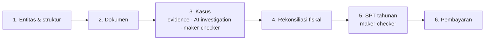

# Nexora 🛡️

<div align="center">

[](https://nexora-chi-cyan.vercel.app)
[](https://cloud.google.com)
[](https://cloud.google.com)
[](https://github.com/fabrianivan/nexora/actions)
[](./LICENSE)

<br/>

[](https://nextjs.org)
[](https://react.dev)
[](https://www.typescriptlang.org)
[](https://tailwindcss.com)
[](https://ai.google.dev)
[](https://vitest.dev)
[](https://eslint.org)

<br/>

[](#)
[](#)
[](#)
[](#)
[](#)

</div>

---

**Nexora** is a multi-country corporate tax compliance workspace — document intake, a rule-based risk engine, AI-assisted case investigation and fiscal reconciliation — designed for corporate tax directors, CFOs, and tax consultants across Southeast Asia and the United States (Indonesia full P0 depth; Singapore, Malaysia, and US statutory previews).

Submitted for **Google Cloud AI Builder Cup, Track 1: BFSI (Smart Risk, Fraud Prevention & Financial Experience)**.

- **Live Production URL**: <https://nexora-chi-cyan.vercel.app>
- **Active Branch**: `main`

---

## 🌟 One connected compliance cycle

Nexora is organised around the 6-step cycle a tax team actually runs. Each step feeds the next, so a finding becomes a case, a confirmed case becomes a fiscal correction, the correction changes the return, and the approved return issues the billing code — no copy-paste between screens. Everything works with sample data and no API key.



| Step | Module | What it does |
|---|---|---|
| — | **Ringkasan** (`/overview`) | Group dashboard: dues ≤ 30 days, open findings, exposure, compliance score per entity, action centre, VAT trend, next deadlines. |
| 1 | **Entitas & struktur** (`/entities`) | Org chart of the group, entity profiles, legal-document checklist (uploads wait for a person to mark them checked), shareholders/UBO, add subsidiaries, group consolidation & Pillar Two threshold. |
| 2 | **Dokumen** (`/documents`) | Inbox of e-Faktur / invoices / share registers per entity. Upload (PDF/PNG/JPG ≤ 10 MB), AI extraction with per-field confidence, manual override, verification. |
| 3 | **Kasus** (`/cases`) | One screen per finding. A deterministic rule engine (TBTS, Missing Trader, split invoicing, Z-Score outliers, MyInvois UUID, non-deductible costs, vendor & share-register cross-validation) opens the case; the case shows the checks that fired, the flagged document fields with per-field extraction confidence, the rule basis, an **AI investigation** with cited steps, the maker-checker decision, and a **Rupiah trail** (what the correction does to PPh due, computed by the same CIT engine as the return). `/risk` and `/review` redirect here. |
| 4 | **Rekonsiliasi fiskal** (`/calculation`) | Commercial → fiscal reconciliation per entity, CIT for ID (Pasal 31E), SG (partial exemption), MY (SME tiers), US (21%); tax credits; VAT recap with blocked input VAT; withholding calculator; what-if simulator. |
| 5 | **SPT tahunan** (`/tax-return`) | SPT 1771 / Form C-S / Borang C / Form 1120 generated live from the reconciliation, pre-submission checks, maker-checker approval that locks the figures, XML/JSON export, print. |
| 6 | **Pembayaran** (`/payments`) | All liabilities across jurisdictions, billing codes, NTPN recording, overdue detection and indicative penalties. Approving the return issues the PPh 29 / balance-due billing automatically. |
| | **Kalender**, **Pemegang saham & UBO**, **Laporan & audit**, **Studi & simulator** | Deadlines with .ics export, group-wide UBO register with PII masking & dividend WHT simulator, executive report & append-only audit trail (CSV), treaty / Pillar Two / TP simulators and knowledge library. |

Design: an editorial system — warm paper, serif headlines and figures (Newsreader), one Prussian-blue accent and a highlighter mark for the thing to look at. Every cycle page ends its header with a **Berikutnya** line: what is still open on that step, and where to go next.

Cross-cutting: **⌘K command palette** (pages, entities, findings, documents), live **notifications**, **RBAC personas** (parent executives see the group; subsidiary staff are scoped to their entity), and the **Tax Copilot** side panel, which can be scoped to a single case.

---

## 🏛️ Architecture

```text
src/
├── app/                     Next.js App Router — one route per module
│   ├── layout.tsx           Fonts, globals, <Providers>
│   ├── providers.tsx        WorkspaceProvider + UiProvider + AppShell
│   ├── overview/ entities/ entities/[id]/ documents/ cases/ (risk/ review/ redirect)
│   ├── calculation/ tax-return/ payments/ calendar/ shareholders/ reports/ studies/
│   └── api/                 bootstrap · sync · reset · status · copilot · investigate · scan-document
├── features/                Feature modules (one folder per route)
├── shell/                   Sidebar, top bar, command palette, notifications,
│                            account/RBAC menu, copilot, toasts, cycle status
├── ui/                      Design system: Button, Card, Badge, Field, Dialog, Sheet,
│                            Tabs, Table, MetricBand (dark/light), Meter, charts (SVG) …
├── state/                   WorkspaceProvider (single source of truth, DB sync), UI state
├── lib/
│   ├── compliance.ts        Documents → risk engine → maker-checker review → corrections
│   ├── cases.ts             Per-case checks, flagged fields, serialisable case context
│   ├── investigation.ts     Investigation tools, offline plan, cited brief + validation
│   ├── rupiahTrail.ts       Correction → PPh due before/after (real CIT engine)
│   ├── ai/                  Gemini client, engine badges, grounded Copilot, investigator loop
│   ├── cit.ts               Corporate income tax per jurisdiction
│   ├── fraud.ts             Rule engine & Z-Score (used by compliance.ts)
│   ├── crossValidation.ts   Vendor/share-register consistency checks
│   ├── returns.ts           Return draft + XML serialisation
│   ├── database.ts          SQLite (node:sqlite) / MySQL / memory persistence
│   └── format.ts fx.ts schedule.ts download.ts
└── data/                    Sample group, personas, seed dataset, country configs,
                             taxCorpus.ts (rule library: internal summaries, marked unverified)
```

Persistence: entity, payment, calendar, audit and study tables plus an `app_state` key/value table holding the compliance workspace (`compliance`) and per-entity reconciliations & returns (`ledger`). The database is re-seeded automatically when the sample dataset version changes.

---

## 🤖 AI, and what it is not allowed to do

Every AI output carries an engine badge: **Gemini · live** (with the model id) or **Simulasi lokal · offline**, plus **fallback** when a live call failed and the local engine answered instead. Confidence is shown as a word with its basis, never as a percentage.

| Surface | Live (`GEMINI_API_KEY` set) | Offline (no key) | Guardrails |
|---|---|---|---|
| **Tax Copilot** (`/api/copilot`) | Gemini answers only from the numbered sources it is given (case data, workspace findings, rule library) and must cite them | Composes the answer from the same sources | Off-topic and prompt-injection questions are refused before any model call; citations that point at nothing are dropped; "no source" is said plainly |
| **Case investigation** (`/api/investigate`) | Gemini function calling over 8 deterministic tools (vendor master, vendor history, tax math, supporting docs, same-day invoices, share register, extraction confidence, e-invoice UUID) | A rule-specific plan runs the same tools | Every brief line must cite tool steps that ran; uncited lines are dropped; the result is a suggestion for the maker, never a decision |
| **Document extraction** (`/api/scan-document`) | Gemini reads the file (PDF/PNG/JPG ≤ 3 MB) and returns fields with per-field confidence; text addressed to an AI inside the document is surfaced, not followed | Values are generated from the file name and labelled as a simulation | Extraction never marks a vendor as validated |

The rule library (`src/data/taxCorpus.ts`) is a set of short internal summaries, marked `verified: false`; answers that rely on it say so. The model id is configurable with `GEMINI_MODEL` (default `gemini-2.5-flash`). Fraud rules, scores, the CIT engine and maker-checker always run deterministically.

| Infrastructure | Status |
|---|---|
| **Cloud Run / Vercel** | Next.js standalone build; set `GEMINI_API_KEY` as a server-side secret |
| **MySQL** | Persistent workspace via `MYSQL_URL`; SQLite/in-memory fallback with zero setup |
| **Document AI, BigQuery** | Not used. Environment variables are reserved for a future adapter |

---

## 🚀 Quick Start (Local Setup)

### Prerequisites
- Node.js 18+ (tested on Node.js 20+)
- npm 9+

### 1. Clone & Install
```bash
git clone https://github.com/fabrianivan/nexora.git
cd nexora
npm install
```

### 2. Configure Environment (Optional)
```bash
cp .env.example .env.local
```
- Leave `GEMINI_API_KEY` blank to run every AI surface offline (zero setup, labelled in the UI).
- Add `GEMINI_API_KEY=your_key_here` (and optionally `GEMINI_MODEL`) to enable live Gemini.
- `MYSQL_URL` is optional; if omitted, Nexora automatically activates the robust in-memory workspace repository.

### 3. Run Dev Server
```bash
npm run dev
```
Open [http://localhost:3000](http://localhost:3000). The sample group loads automatically; reset it from the sidebar's database footer or the command palette.

---

## 🧪 Testing & Code Quality

Checks run on every change:

```bash
# Run unit tests (tax engine, CIT per country, risk engine, maker-checker, cases, investigation, copilot grounding)
npm run test

# Run TypeScript typecheck with zero errors
npm run typecheck

# Run ESLint with zero errors and zero warnings
npm run lint

# Build standalone production bundle
npm run build

# Run Playwright end-to-end smoke tests
npm run test:e2e
```

---

## 👥 Role-Based Access Control (RBAC) & Governance

Switch persona from the account menu (top right). Access follows segregation of duties:

| Persona | Scope | Maker | Checker |
|---|---|---|---|
| Group CEO · Group CFO (parent company) | All entities | ✓ | ✓ (never on their own proposal or draft) |
| Director SG · Director MY · Controller US | Own entity only | ✓ | — |

- Maker-checker applies to **case decisions** (Kasus) and **annual returns** (SPT tahunan); the UI offers a one-click switch to an eligible checker for demos.
- Subsidiary personas cannot open other entities; identity numbers in the UBO register are masked unless revealed (the reveal is audit-logged).
- Every mutation writes to the append-only audit trail (Laporan & audit → Jejak audit, CSV export).

---

## 📄 License

Nexora is released under the [MIT License](./LICENSE). Built for the Google Cloud AI Builder Cup 2026.
