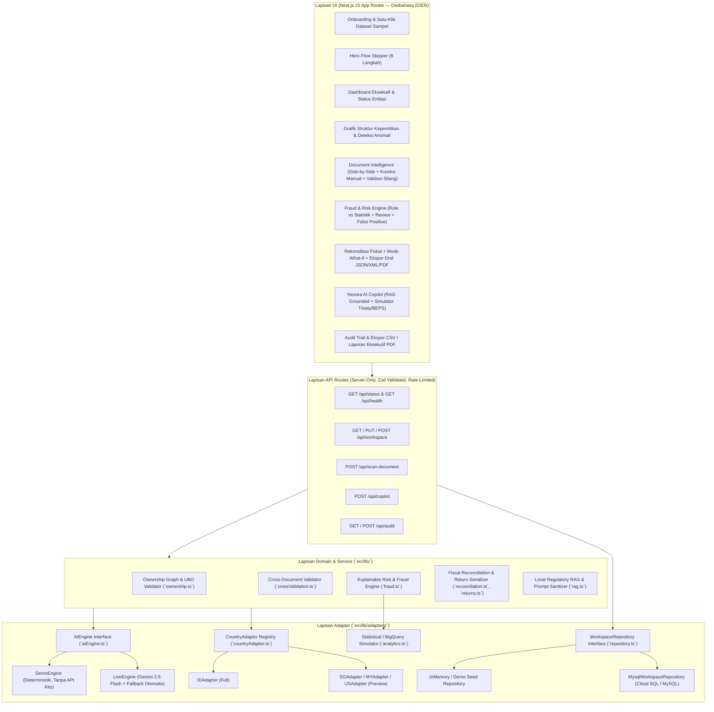

# Arsitektur Sistem & Model Data Nexora (Fase 2)

Dokumen ini menjelaskan arsitektur berlapis (*layered architecture*), kontrak antarmuka (*adapter interfaces*), dan model data tervalidasi Zod pada Nexora v2.

---

## 1. Diagram Arsitektur Berlapis



---

## 2. Kontrak Antarmuka Utama (Interfaces)

### 2.1 `AIEngine` Interface (`src/lib/adapters/aiEngine.ts`)
Menjamin kontrak input dan output yang **100% identik** (divalidasi dengan skema Zod yang sama) antara mode tanpa API key (`DemoEngine`) dan mode `GEMINI_API_KEY` (`LiveEngine`), dengan mekanisme timeout, retry dengan exponential backoff, dan fallback otomatis ke `DemoEngine` jika panggilan eksternal gagal.

```typescript
export interface AIEngine {
  readonly mode: 'demo' | 'live';
  readonly providerLabel: string;
  extractDocument(input: DocumentExtractionInput): Promise<DocumentExtractionOutput>;
  askCopilot(input: CopilotQueryInput): Promise<CopilotMessage>;
}
```

- **`DemoEngine`**: Deterministik, mengekstrak field terstruktur berdasarkan inspeksi metadata dan konten sampel serta menjawab pertanyaan Copilot langsung dari dokumen sumber RAG lokal tanpa halusinasi.
- **`LiveEngine`**: Memanggil Google Gemini (`gemini-2.5-flash`) di sisi server dengan sanitasi anti-prompt-injection dan batas waktu (*timeout* 8 detik + 1x retry backoff). Semua output di-parse dengan Zod; bila gagal atau jaringan terputus, otomatis beralih ke `DemoEngine` dengan flag `fallbackUsed: true`.

### 2.2 `CountryAdapter` Interface (`src/lib/adapters/countryAdapter.ts`)
Memungkinkan penambahan yurisdiksi pajak baru tanpa mengubah kode inti pada UI maupun mesin rekonsiliasi/risiko:

```typescript
export interface CountryAdapter {
  code: CountryCode; // 'ID' | 'SG' | 'MY' | 'US'
  name: string;
  authority: string;
  currency: string;
  taxIdFormat: string;
  status: 'full' | 'preview';
  validateTaxId(raw: string): { valid: boolean; normalized: string; message?: string };
  documentTypes: CountryDocumentTypeSpec[];
  invoiceSchema: z.ZodTypeAny;
  riskRules: RiskRuleSpec[];
  fiscalAdjustmentRules: FiscalAdjustmentRuleSpec[];
  returnFormTemplate: {
    formCode: string;
    formName: string;
    authorityPortal: string;
    sections: string[];
  };
  paymentCodes: {
    code: string;
    name: string;
    channel: string;
    description: string;
  }[];
}
```

- **`IDAdapter` (`status: "full"`)**: Dukungan lengkap end-to-end (Coretax DJP, NPWP 15/16 & NITKU, Akta Pendirian, Daftar Pemegang Saham, Laporan Keuangan, SPT 1771 Sebelumnya, e-Faktur, Bukti Potong PPh, aturan TBTS/NSFP/PPN/Non-Deductible/TP, rekonsiliasi fiskal UU PPh, draf SPT 1771, kode akun pajak e-Billing).
- **`SGAdapter`, `MYAdapter`, `USAdapter` (`status: "preview"`)**: Diberi badge `Preview` di UI, masing-masing dengan validator UEN/TIN/EIN, skema InvoiceNow/MyInvois/1099-NEC, aturan risiko spesifik negara, dan template Form C-S / Form C / Form 1120.

### 2.3 `WorkspaceRepository` Interface (`src/lib/mysql.ts` & `src/lib/repository.ts`)
Memisahkan persistensi dari logika aplikasi:
- Jika `MYSQL_URL` dikonfigurasi dan dapat dijangkau, server menggunakan `MysqlWorkspaceRepository`.
- Jika `MYSQL_URL` tidak dikonfigurasi (seperti pada lingkungan demo tanpa database eksternal), server menggunakan `InMemoryWorkspaceRepository` yang sudah di-seed dengan dataset sampel lengkap sehingga demo 3 menit berjalan mulus tanpa hambatan konfigurasi.
- Kontrak ini juga siap diganti ke Cloud SQL, Firestore, atau BigQuery tanpa menyentuh komponen UI.

---

## 3. Model Entitas Data (TypeScript + Skema Zod di `src/lib/domain.ts`)

Seluruh entitas divalidasi dengan Zod di batas API dan penyimpanan:

1. **`Group` & `Entity`**:
   - `Group`: `{ id, name, headquartersCountry, consolidatedRevenueEur, fiscalYear, entities[] }`
   - `Entity`: `{ id, groupId, name, tradeName, country, taxId, secondaryTaxId, currency, address, fiscalYearEnd, status: 'ACTIVE' | 'PENDING_REVIEW', createdAt }`
2. **`OwnershipLink` & `Shareholder`**:
   - `OwnershipLink`: `{ id, parentId, childId, percentage, effectivePercentage, linkType: 'DIRECT' | 'INDIRECT' | 'CIRCULAR_CANDIDATE' }`
   - `Shareholder`: `{ id, entityId, name, shareholderType: 'INDIVIDUAL' | 'CORPORATE', isBeneficialOwner: boolean, nationalityOrJurisdiction, taxId, percentage, effectivePercentage, highRiskJurisdiction: boolean }`
3. **`Document` & `ExtractedField`**:
   - `ExtractedField`: `{ key, label, value, confidence: number (0..1), pageNumber, boundingBoxLabel, source: 'ai' | 'manual', manuallyCorrected: boolean, previousValue?, correctedBy?, correctedAt? }`
   - `Document`: `{ id, entityId, country, type, title, fileName, mimeType, fileSize, version, extractionStatus: 'EXTRACTED' | 'NEEDS_REVIEW' | 'VERIFIED' | 'ERROR', fields: ExtractedField[], rawSummary, uploadedAt }`
4. **`Finding` (Explainable Risk & Fraud Finding)**:
   - `{ id, entityId, documentId?, country, ruleId, category: 'FRAUD' | 'COMPLIANCE' | 'OWNERSHIP' | 'CROSS_VALIDATION' | 'TRANSFER_PRICING', title, severity: 'critical' | 'high' | 'medium' | 'low', score: number (0..100), ruleScoreContribution: number, statScoreContribution: number, confidence: number (0..1), humanReason: string, evidence: FindingEvidenceItem[], recommendation: string, status: 'Baru' | 'Ditinjau' | 'Dikonfirmasi' | 'Ditolak', isFalsePositive: boolean, reviewer?: string, reviewNotes?: string, linkedAdjustmentId?: string, updatedAt }`
   - Memisahkan secara eksplisit kontribusi skor **Aturan Deterministik (`ruleScoreContribution`)** dan **Statistik/Model (`statScoreContribution`)**.
5. **`FiscalAdjustment`**:
   - `{ id, entityId, accountCode, accountName, category: 'REVENUE' | 'COGS' | 'OPEX' | 'OTHER', commercialAmount, adjustmentType: 'POSITIVE' | 'NEGATIVE' | 'NONE', adjustmentAmount, fiscalAmount, ruleBasis, reason, verificationStatus: 'VERIFIED' | 'NEEDS_VERIFICATION', linkedFindingId? }`
6. **`TaxReturnDraft`**:
   - `{ id, entityId, country, formCode, period, watermark: 'DRAF - BUKAN UNTUK DISAMPAIKAN KE OTORITAS', status: 'DRAFT' | 'REVIEWED', summary: { commercialProfit, positiveAdjustments, negativeAdjustments, taxableIncome, statutoryRate, corporateTaxDue, withholdingTaxCredit, netTaxPayable }, paymentReference: { method, code, note }, generatedAt }`
7. **`AuditLogEntry`**:
   - `{ id, timestamp, actor, role, action: 'LOAD_SAMPLE' | 'UPLOAD_DOCUMENT' | 'EDIT_EXTRACTED_FIELD' | 'UPDATE_FINDING_STATUS' | 'MARK_FALSE_POSITIVE' | 'VERIFY_FISCAL_ADJUSTMENT' | 'EXPORT_RETURN_DRAFT' | 'ASK_COPILOT', objectType, objectId, beforeValue: string | null, afterValue: string | null, metadata?: string }`
8. **`CopilotMessage`**:
   - `{ id, question, answer, citations: { code: string; title: string; excerpt: string; jurisdiction: CountryCode }[], confidence: number (0..1), grounded: boolean, engineMode: 'demo' | 'live', fallbackUsed?: boolean, timestamp }`

---

## 4. Keamanan, Privasi & Penanganan Kegagalan

1. **Isolasi Rahasia Server (`server-only`)**: `GEMINI_API_KEY`, `MYSQL_URL`, `NEXORA_ACCESS_TOKEN`, dan `NEXORA_SESSION_SECRET` hanya dibaca di Route Handlers / Server Modules. Tidak ada kunci rahasia dengan prefix `NEXT_PUBLIC_`.
2. **Sanitasi Anti-Prompt-Injection**: Semua teks dari dokumen atau field yang diunggah dibersihkan dari pola instruksi (`ignore previous instructions`, tag sistem, karakter kontrol) dan dibungkus dalam blok `<untrusted_document_data>` yang secara tegas diinstruksikan kepada LLM untuk diperlakukan sebagai **DATA pasif**, bukan perintah.
3. **Masking Data Sensitif**: NPWP, UEN, TIN, EIN, NIK, dan nomor rekening dapat ditampilkan dalam mode ter-masking (`0013•••••••2000`) di UI dan selalu di-masking pada log server.
4. **Kejujuran Komputasi Lokal vs Cloud**: Statistik Z-Score, IQR, dan distribusi digit pertama (Benford's Law) dihitung secara deterministik di server Node.js dan diberi label eksplisit **`Dihitung lokal (simulasi BigQuery)`** bila koneksi BigQuery live tidak aktif.
