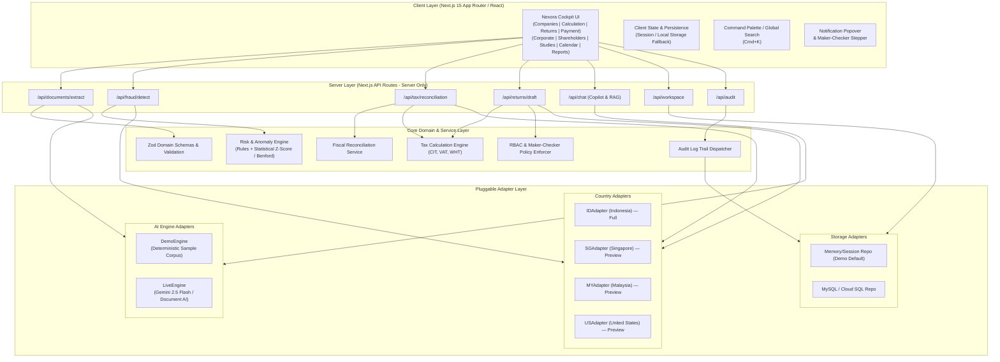

# Nexora — System Architecture & Data Model Specification

> **Version**: 3.0-dev  
> **Target Track**: Google Cloud AI Builder Cup — Track 1 BFSI  
> **Status**: Approved Architectural Baseline (Phase 2)  

---

## 1. System Architecture Overview

Nexora follows a clean multi-tiered architecture separating client presentation, server orchestration, business domain logic, and external/simulated infrastructure adapters.



---

## 2. Layer Specifications

### 2.1 UI Layer
- Next.js 15 App Router with Tailwind CSS (v4) and modern design tokens.
- Strict layout fidelity matching the Figma reference (Navy sub-nav `#0F172A`, asymmetric corporate forms, side-by-side document viewer, modal drawers, and status badges).
- Built-in internationalization (ID default, EN secondary) via dictionary tokens.
- Immediate empty states, accessible error callouts, and skeleton loaders.

### 2.2 Server API Layer (`src/app/api/*`)
- Server-only execution (`import 'server-only'`).
- Enforces runtime input/output validation with Zod schemas.
- Validates user persona permissions and maker-checker rules before committing actions.
- Rate limiting and prompt sanitization to eliminate prompt-injection vulnerabilities.

### 2.3 AI Engine Architecture & Fallback
Both `DemoEngine` and `LiveEngine` implement an identical TypeScript interface:

```typescript
export interface AIEngine {
  extractDocument(file: { buffer: Buffer; mimeType: string; name: string }): Promise<ExtractedDocumentResult>;
  analyzeFraudAndRisk(transactions: Transaction[], entity: CorporateEntity): Promise<Finding[]>;
  chatCopilot(query: string, context: CopilotContext): Promise<CopilotResponse>;
}
```

- **LiveEngine**: Connects to Google Cloud Document AI (`projects/.../locations/.../processors/...`) and Gemini API (`gemini-2.5-flash`).
- **DemoEngine**: Deterministic, zero-latency extraction and grounded answering on standard sample datasets without requiring API keys or incurring costs.
- **Failover**: If `GEMINI_API_KEY` is absent, invalid, or hits quota/timeout errors, the server automatically falls back to `DemoEngine` and tags the response with `engine: "simulasi_local"` and a user-friendly UI toast notification.

---

## 3. Country Adapter Interface & Versioned Tax Config

### 3.1 Interface Specification
```typescript
export interface CountryAdapter {
  code: 'ID' | 'SG' | 'MY' | 'US';
  name: string;
  authority: string;
  currency: string;
  taxIdFormat: RegExp;
  taxIdLabel: string;
  status: 'full' | 'preview';
  
  validateTaxId(taxId: string): { valid: boolean; formatted: string; reason?: string };
  documentTypes: Array<{ type: string; label: string; required: boolean }>;
  riskRules: RiskRuleDefinition[];
  fiscalAdjustmentRules: FiscalAdjustmentRule[];
  taxRates: VersionedTaxConfig;
  deadlineRules: DeadlineRuleDefinition[];
  returnFormTemplate: TaxReturnTemplate;
  paymentCodeGenerators: PaymentCodeConfig[];
}
```

### 3.2 Implemented Adapters
1. **IDAdapter (`Indonesia`)**:
   - Status: **Full Coverage (P0 Hero Flow)**.
   - Authority: Direktorat Jenderal Pajak (DJP).
   - Currency: IDR (`Rp`).
   - Tax ID: NPWP (15 or 16 digits).
   - Rules: PPh Badan (UU HPP 22%), PPN (UU HPP 11%), e-Faktur TBTS fraud screening, PPh 21/23/26/4(2), SPT 1771 Induk + Lampiran I-VI draft, e-Billing code simulator.
2. **SGAdapter (`Singapore`)**:
   - Status: **Preview Adapter (P1)**.
   - Authority: Inland Revenue Authority of Singapore (IRAS).
   - Currency: SGD (`S$`).
   - Tax ID: UEN (Unique Entity Number).
   - Rules: Form C-S draft, GST 9% input/output matching, InvoiceNow validation, Missing Trader (MTIC) risk indicators.
3. **MYAdapter (`Malaysia`)**:
   - Status: **Preview Adapter (P1)**.
   - Authority: Lembaga Hasil Dalam Negeri (LHDN).
   - Currency: MYR (`RM`).
   - Tax ID: TIN.
   - Rules: Form C draft, SST 8%, e-Invoice MyInvois UUID validation checks.
4. **USAdapter (`United States`)**:
   - Status: **Preview Adapter (P1)**.
   - Authority: Internal Revenue Service (IRS).
   - Currency: USD (`$`).
   - Tax ID: EIN / TIN.
   - Rules: Form 1120 draft, Federal 21% CIT simulation, Section 482 intercompany transfer pricing range.

### 3.3 Versioned Regulatory Config Files
All statutory tax rates, withholding thresholds, interest penalty formulas, and filing deadlines are maintained in dedicated configuration files:
- `src/config/taxRules.id.json`
- `src/config/taxRules.sg.json`
- `src/config/taxRules.my.json`
- `src/config/taxRules.us.json`

Each entry provides:
```json
{
  "key": "corporate_income_tax_rate",
  "value": 0.22,
  "regulation": "UU No. 7 Tahun 2021 (UU HPP) Pasal 17 ayat (1) huruf b",
  "effectiveDate": "2022-01-01",
  "verified": true,
  "flag": null
}
```
If a rule is estimated or pending legislative ratification, it is stored with `"verified": false` and `"flag": "perlu verifikasi"`.

---

## 4. Comprehensive Domain Entities (Zod + TypeScript)

The domain model covers the full 360° compliance lifecycle:

```typescript
// 1. Group & Entity
CorporateGroup
CorporateEntity (id, name, country, taxId, address, fiscalYearEnd, status, currency)
OwnershipLink (id, parentId, childId, percentage, type: direct | indirect | beneficial)
Shareholder (id, entityId, name, type: individual | corporate, idNumber, sharePercentage, isUbo, taxResidency)
IntermediateShareholder (id, entityId, name, jurisdiction, sharePercentage, bepsScreeningStatus, riskLevel)

// 2. Documents & Extractions
TaxDocument (id, entityId, country, type, fileName, fileSize, mimeType, extractedFields, status, version)
ExtractedField<T> (value: T, source: 'ai' | 'manual', confidence: number, location?: BoundingBox, status: 'raw' | 'edited')

// 3. Risk & Fraud Detection
Finding (
  id, entityId, ruleId, ruleName, category: 'fraud' | 'compliance' | 'transfer_pricing' | 'beps',
  severity: 'critical' | 'high' | 'medium' | 'low',
  score: number (0-100), confidence: number (0-1),
  reason: string,
  evidence: Array<{ field: string; expected: string; actual: string; sourceRef: string; mathSnippet?: string }>,
  recommendation: string,
  status: 'Baru' | 'Ditinjau' | 'Dikonfirmasi' | 'Ditolak',
  reviewer?: string, reviewerNotes?: string, updatedAt: string
)

// 4. Fiscal Reconciliation & Tax Calculation
FiscalAdjustment (id, entityId, type: 'positive' | 'negative', accountCode, accountName, amount, ruleBasis, verified: boolean)
TaxCalculation (id, entityId, taxType: 'CIT' | 'VAT' | 'WHT', period, commercialProfit, adjustments: FiscalAdjustment[], taxableIncome, calculatedTax, credits, underpayment, assumptions)

// 5. Tax Return Drafts & Workflow
TaxReturnDraft (id, entityId, country, formType, period, data: Record<string, unknown>, status: 'Draft' | 'Review' | 'Approved' | 'Ready', createdBy, approvedBy, exportedAt)

// 6. Payment & Calendar
PaymentRecord (id, entityId, taxType, period, billingCode, amount, dueDate, status: 'Belum dibayar' | 'Dibayar' | 'Terlambat' | 'Parsial', proofAttachmentUrl)
TaxDeadline (id, entityId, obligationType, dueDate, status: 'Upcoming' | 'Today' | 'Overdue' | 'Completed', assignee, linkedReturnId, linkedPaymentId)

// 7. Governance, Maker-Checker & Audit
UserRole: 'CEO Grup' | 'Head of Tax' | 'Konsultan Pajak' | 'Auditor/Compliance' | 'Viewer'
ApprovalRequest (id, objectType: 'return' | 'adjustment' | 'payment', objectId, requesterId, approverId, status: 'Pending' | 'Approved' | 'Rejected', timestamp)
AuditLogEntry (id, timestamp, actor: string, role: string, action: string, targetType: string, targetId: string, beforeValue?: unknown, afterValue?: unknown)

// 8. Copilot & RAG
CopilotMessage (id, sender: 'user' | 'assistant', text: string, citations: Array<{ source: string; article: string; textSnippet: string }>, confidence: number, grounded: boolean)
```

---

## 5. Storage & Persistence Strategy

1. **In-Memory & Session Storage (Default Demo Mode)**:
   - Zero-configuration setup out of the box.
   - Initialized with realistic sample multi-entity group (`PT Nusantara Prima Group`, `PT Sumber Logistik Nusantara`, `Nexora Global Holdings Pte Ltd`).
   - Changes persist in memory across the browser session; 1-click **"Muat Ulang Data Contoh"** resets state to the clean baseline.
2. **MySQL / Cloud SQL (Production Mode)**:
   - Activated automatically when `MYSQL_URL` is set in environment.
   - Abstracted through `WorkspaceRepository` interface. If `MYSQL_URL` is absent, the server falls back to `MemoryWorkspaceRepository` rather than returning a 503 error.
