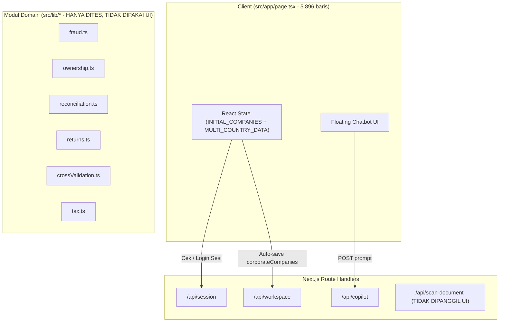

# Audit Teknis & Produk Nexora (Fase 0)

Dokumen ini merangkum kondisi aktual repositori `nexora` sebelum dilakukan perombakan konsep dan implementasi (`improve/concept-v2`). Seluruh temuan diverifikasi langsung dari kode sumber di `src/`, `test/`, `e2e/`, `docs/`, konfigurasi proyek, dan alur runtime.

---

## 1. Peta Arsitektur Aktual

### 1.1 Halaman & Antarmuka Pengguna (UI)
- **`src/app/layout.tsx`**: Root layout Next.js 15 App Router (font `Inter`, bahasa `id`).
- **`src/app/page.tsx` (5.896 baris — Monolitik Client Component)**:
  - Mengandung seluruh state aplikasi, autentikasi sesi klien, 4 tab navigasi utama (`Companies`, `Calculation`, `Tax Return`, `Payment`), 5 sub-navigasi (`Corporate`, `Individual Shareholder`, `Studies`, `Tax Calendar`, `Reports`), 5 modal, dan floating chatbot.
  - Menggunakan data statis dari `INITIAL_COMPANIES` (didefinisikan di dalam `page.tsx` baris 256–1198) dan `MULTI_COUNTRY_DATA` (`src/data/multiCountryTaxData.ts`).
- **`public/index-standalone.html` (533 baris)**: Prototipe statis HTML+Tailwind CDN warisan yang tidak terhubung dengan aplikasi Next.js.

### 1.2 API Routes (`src/app/api/`)
1. **`GET / POST / DELETE /api/session` (`src/app/api/session/route.ts`)**:
   - Memeriksa konfigurasi `NEXORA_ACCESS_TOKEN` dan `NEXORA_SESSION_SECRET`.
   - Menukar `token` dengan cookie HMAC-SHA256 `nexora_session` (berlaku 8 jam, `httpOnly`, `sameSite: 'strict'`).
2. **`GET / PUT /api/workspace` (`src/app/api/workspace/route.ts`)**:
   - Mewajibkan sesi valid (`isSessionValid`) dan `MYSQL_URL`.
   - Membaca/menyimpan satu JSON blob ber-key `'default'` ke tabel MySQL `nexora_workspaces` (batas ukuran 5 MB, divalidasi dengan `workspaceSchema`).
3. **`POST /api/copilot` (`src/app/api/copilot/route.ts`)**:
   - Mewajibkan sesi valid (`isSessionValid`) dan rate limit (`20 req / 60 detik`).
   - Jika `GEMINI_API_KEY` tersedia: memanggil REST endpoint `https://generativelanguage.googleapis.com/v1beta/models/gemini-2.5-flash:generateContent` tanpa RAG/grounding dan mengembalikan `citations: []`.
   - Jika `GEMINI_API_KEY` kosong atau gagal: mengembalikan pesan penolakan statis bahwa sumber resmi belum dapat diverifikasi.
4. **`POST /api/scan-document` (`src/app/api/scan-document/route.ts`)**:
   - Mewajibkan sesi valid (`isSessionValid`) dan rate limit (`10 req / 60 detik`).
   - **Tidak menerima byte file**. Hanya menerima JSON `{ fileName, customVendor, customDpp, customTax, country }` lalu menghitung aritmetika sederhana (`dpp * cfg.indirectTaxRate`) dan memeriksa apakah `fileName` mengandung kata `'fiktif' | 'fraud' | 'tbts'`.
   - **Catatan penting**: Endpoint `/api/scan-document` bahkan **tidak dipanggil** oleh `src/app/page.tsx`.
5. **`GET /api/status` (`src/app/api/status/route.ts`)**:
   - Mengembalikan status boolean konfigurasi environment (`mode`, `gemini`, `documentAi: false`, `documentScanner: 'simulation-only'`, `bigQuery`, `mysqlConfigured`). Tidak dipanggil oleh UI.

### 1.3 Modul Logika Domain (`src/lib/`) & Data (`src/data/`)
- **`src/lib/domain.ts`**: Skema Zod untuk `entitySchema`, `ownershipSchema`, `documentSchema`, `reconciliationLineSchema`, dan `workspaceSchema`.
- **`src/lib/ownership.ts`**: Fungsi `validateOwnership()` untuk mendeteksi persentase != 100%, circular ownership (DFS), dan referensi entitas hilang.
- **`src/lib/fraud.ts`**: Fungsi `detectFraud()` dan `zScores()` untuk 6 aturan (`TBTS`, `MISSING_TRADER`, `MYINVOIS_UUID`, `NON_DEDUCTIBLE`, `SPLIT_INVOICING`, `Z_SCORE`).
- **`src/lib/crossValidation.ts`**: Fungsi `crossValidateDocuments()` untuk memeriksa inkonsistensi nama/NPWP lawan transaksi dan total saham.
- **`src/lib/tax.ts`**: Fungsi `simulateTax()` untuk pajak badan, PPN/GST, WHT domestik vs treaty, dan top-up Pillar Two.
- **`src/lib/reconciliation.ts`**: Fungsi `calculateReconciliation()`.
- **`src/lib/returns.ts`**: Fungsi `createReturnDraft()` dan serializer XML `returnDraftToXml()`.
- **`src/lib/mysql.ts`**: Implementasi `MysqlWorkspaceRepository`.
- **`src/lib/chatMarkdown.ts`**: Parser markdown kustom untuk balon chat Copilot.
- **`src/data/indonesiaTaxData.ts` & `src/data/multiCountryTaxData.ts`**: Dataset fixture untuk ID, SG, MY, US. Namun pada baris 850–889 di `multiCountryTaxData.ts` dan baris 1182–1198 di `page.tsx`, seluruh skor, status, dan alasan di-reset paksa menjadi `0` / `'SIMULASI'` / `individualShareholders: []` oleh mutasi loop di akhir file.

### 1.4 Alur Data Aktual

---

## 2. Fitur yang Benar-Benar Berfungsi vs Mock / Hardcoded

| Area Fitur | Status Aktual di Kode | Detail Verifikasi |
|---|---|---|
| **Autentikasi Sesi Operator** | **Berfungsi sebagian (Penghalang Demo)** | Di `production` (termasuk Vercel/Cloud Run), jika `NEXORA_ACCESS_TOKEN` dan `NEXORA_SESSION_SECRET` tidak diset, `/api/session` mengembalikan HTTP 503 dan UI memblokir seluruh halaman dengan pesan *"Akses belum dikonfigurasi"*. Di `development` tanpa env, masuk ke mode `'preview'`, namun `/api/copilot` tetap menolak dengan HTTP 401 karena `isSessionValid(req)` bernilai `false`! |
| **Mesin Domain (`src/lib/fraud.ts`, `ownership.ts`, `reconciliation.ts`, `returns.ts`, `crossValidation.ts`, `tax.ts`)** | **Dead Code terhadap UI (Hanya dipakai di `test/domain.test.ts`)** | Keenam modul ini memiliki logika deterministik yang bersih dan lulus unit test, **tetapi sama sekali tidak di-import atau dipanggil oleh `src/app/page.tsx` maupun API route mana pun** (kecuali `domain.ts` di `/api/workspace`). |
| **Data Contoh (Dataset Sampel)** | **Rusak oleh Post-Mutation Loop** | `multiCountryTaxData.ts` (baris 850–889) menimpa semua `taxHealthScore = 0`, `riskScore = 0`, `bqZScore = 0`, `confidenceScore = 0`, `legalBasis = 'PERLU VERIFIKASI AHLI PAJAK.'`. Akibatnya, saat UI dibuka, semua transaksi berisiko menampilkan `Risk 0/100 (LOW)` dan `Z-Score: 0σ`, serta `individualShareholders` dikosongkan (`[]`) di `page.tsx` baris 1197. |
| **Document Scanner / Upload** | **Mock / Simulasi Kosong** | Tombol "Upload" di `page.tsx` hanya memanggil `handleRunDocAiVerification()` yang menjalankan `setTimeout` 750ms lalu menampilkan toast *"Simulasi saja: belum ada file yang diunggah"*. Tidak ada `<input type="file">`, tidak ada validasi file, tidak ada tampilan berdampingan (side-by-side), dan tidak ada koreksi manual per field. |
| **Struktur Kepemilikan** | **Hardcoded Visual** | Menampilkan kartu statis dari `structureNodes`, `intermediateShareholders`, dan `individualShareholders` (yang kosong karena di-reset `[]`). Tidak memanggil `validateOwnership()`, tidak mendeteksi circular ownership atau persentase != 100% secara dinamis. |
| **Fraud & Risk Engine di UI** | **Hardcoded & Di-nol-kan** | Tab `Studies` hanya me-render array statis `cfg.auditTransactions` yang nilainya sudah di-overwrite menjadi `riskScore: 0`, `riskLevel: 'LOW'`. Tombol `Auto-Remediate` bahkan tidak muncul karena syaratnya `trx.riskLevel !== 'LOW'`. |
| **Rekonsiliasi Fiskal & Draf SPT** | **Hardcoded & Tombol Ekspor Palsu** | Tabel rekonsiliasi hanya menampilkan `cfg.fiscalReconciliation` tanpa bisa diedit/diverifikasi per baris. Tombol *"Export Official Tax Return (.JSON / .XML)"* di tab `Tax Return` hanya memunculkan toast tanpa mengunduh file JSON/XML/PDF ataupun memanggil `createReturnDraft()`. |
| **AI Copilot** | **Berfungsi tanpa Grounding (Terhalang Auth di Mode Preview)** | Memanggil Gemini 2.5 Flash jika `GEMINI_API_KEY` ada DAN sesi login aktif. Namun tidak memiliki retrieval/RAG terhadap basis pengetahuan regulasi, selalu mengembalikan `citations: []`, dan gagal dengan 401 di mode preview lokal tanpa login. |
| **Audit Log** | **Tidak Ada** | Tidak ada pencatatan audit trail (aktor, aksi, objek, sebelum/sesudah, timestamp) maupun ekspor CSV. |

---

## 3. Layanan Google Cloud: Aktual Dipanggil vs Hanya Disebut

| Layanan Google Cloud | Klaim di UI / Dokumen Lama | Kenyataan di Kode Sumber |
|---|---|---|
| **Gemini API (`gemini-2.5-flash`)** | Copilot Pajak & Ekstraksi Multimodal | **Dipanggil sebagian**: Hanya dipanggil via `fetch` REST di `/api/copilot` untuk chat teks biasa. Tidak digunakan untuk ekstraksi dokumen multimodal. |
| **Google Cloud Run** | Containerized Deployment | **Siap pakai**: `Dockerfile` multi-stage Node 22 Alpine + `output: 'standalone'` di `next.config.mjs` sudah benar. |
| **Google Cloud Document AI** | Disebut di metadata layout, header HTML standalone, dan label dokumen | **Tidak dipanggil**: Hanya ada variabel `.env.example` (`DOCUMENT_AI_PROCESSOR_ID`). Tidak ada SDK atau panggilan API. |
| **Google Cloud BigQuery & BigQuery ML** | Disebut di sub-nav `Studies ("BIGQUERY ML + VERTEX AI FORENSIC STUDIES")` | **Tidak dipanggil**: Hanya ada variabel `.env.example` (`BIGQUERY_DATASET`). Z-Score di `src/lib/fraud.ts` dihitung lokal di memori (dan belum dihubungkan ke UI). |
| **Vertex AI Search / RAG** | Disebut di `docs/ARCHITECTURE.md` | **Tidak dipanggil**: Tidak ada retrieval atau basis pengetahuan terstruktur yang disuntikkan ke prompt Copilot. |

---

## 4. Daftar Bug, Dead Code, Duplikasi, Masalah Keamanan & UX

### 4.1 Bug Kritis & Logika
1. **Deadlock Autentikasi pada Mode Demo/Preview**:
   - Di `src/app/page.tsx` (baris 1319), jika `/api/session` mengembalikan 503 di `NODE_ENV === 'development'`, aplikasi masuk ke `sessionStatus = 'preview'`. Namun ketika pengguna mencoba memakai AI Copilot (`/api/copilot`), route handler memeriksa `if (!isSessionValid(req)) return 401`. Hasilnya: Copilot gagal di mode preview.
   - Lebih parah lagi, di `NODE_ENV === 'production'` (mis. saat di-deploy ke Cloud Run atau Vercel tanpa menyetel `NEXORA_ACCESS_TOKEN`), aplikasi terkunci total di layar *"Akses belum dikonfigurasi"* sehingga juri tidak bisa mencoba aplikasi sama sekali.
2. **Penghancuran Data Sampel oleh Loop Mutasi di Akhir File**:
   - Di `src/data/multiCountryTaxData.ts` (baris 850–889), terdapat loop `for (const jurisdiction of Object.values(MULTI_COUNTRY_DATA))` yang menimpa seluruh `riskScore = 0`, `riskLevel = 'LOW'`, `bqZScore = 0`, `taxHealthScore = 0`, dan `confidenceScore = 0`.
   - Di `src/app/page.tsx` (baris 1182–1198), `.map()` pada `INITIAL_COMPANIES` mengosongkan `individualShareholders: []` dan mengubah `aiComplianceScore: 0`. Akibatnya tab *Individual Shareholder* menampilkan tabel kosong (0 baris) tetapi kartu KPI di atasnya menulis hardcoded `100% DOCUMENT AI KYC & PEP/FATF VERIFIED`.
3. **ketidaksinkronan `AI_BUILDER_CUP_SUBMISSION_GUIDE.md` vs Kode Aktual**:
   - Panduan submission (baris 31–37) menginstruksikan juri untuk mengklik *"Extract with Gemini Vision"*, mengedit field ekstraksi, membuka tab *"Risk"*, dan mengekspor JSON/XML/PDF. Fitur-fitur tersebut ada di versi kode yang sempat dibuat di `src/lib/*`, namun UI `src/app/page.tsx` di-revert pada commit `revert: restore comprehensive fintech UI` sehingga UI dan modul `src/lib/*` terputus total.
4. **Injeksi Konteks Prompt Tanpa Sanitasi**:
   - Pada `src/app/page.tsx` baris 1783, nama entitas dan input pengguna digabung langsung ke dalam string `prompt` tanpa pemisahan data vs instruksi maupun sanitasi karakter kontrol.

### 4.2 Dead Code & Duplikasi
1. **Seluruh modul analitik di `src/lib/` adalah dead code bagi UI**:
   - `src/lib/ownership.ts`, `src/lib/fraud.ts`, `src/lib/crossValidation.ts`, `src/lib/tax.ts`, `src/lib/reconciliation.ts`, dan `src/lib/returns.ts` hanya dipanggil oleh `test/domain.test.ts`.
2. **Endpoint `/api/scan-document` dan `/api/status`**:
   - Tidak pernah dipanggil dari mana pun di frontend maupun test.
3. **File `public/index-standalone.html`**:
   - Duplikasi UI lama (533 baris) yang memuat Tailwind dari CDN eksternal (`https://cdn.tailwindcss.com`) dan menampilkan klaim palsu *"Google Cloud Document AI + BigQuery + Vertex AI Connected"*.
4. **Duplikasi Definisi Tipe**:
   - `CountryCode` dan `CorporateEntity` didefinisikan ulang secara berbeda di `src/lib/domain.ts`, `src/data/multiCountryTaxData.ts`, dan `src/app/page.tsx`.
5. **Test yang Terlewat oleh Vitest**:
   - `test/chatMarkdown.test.mjs` memakai `node:test`, sedangkan `vitest.config.mts` hanya menyertakan `test/**/*.test.ts`, sehingga `chatMarkdown.test.mjs` tidak pernah dijalankan oleh `npm test`.

### 4.3 Masalah Keamanan & Kepatuhan
1. **Tidak Ada Content Security Policy (CSP)** di `next.config.mjs`.
2. **Tidak Ada Timeout & Retry Backoff** pada panggilan `fetch` ke Gemini API di `/api/copilot/route.ts` (jika Gemini lambat, request menggantung).
3. **Rate Limiter Global Berbasis String Konstan**:
   - Di `/api/copilot/route.ts`: `rateLimit('copilot:session', 20)` menggunakan key statis `'copilot:session'` untuk seluruh pengguna, bukan per IP atau sesi.
4. **Tidak Ada Sanitasi Prompt Injection**:
   - Isi dokumen/field entitas belum dibungkus sebagai blok data yang terisolasi dari instruksi sistem.

### 4.4 Masalah UX & Aksesibilitas
1. **Monolitik 5.896 Baris Tanpa Alur Jelas (No Hero Flow)**:
   - Pengguna disajikan puluhan tombol, sub-tab, dan modal yang saling tumpang tindih tanpa urutan kerja (stepper) dari hulu ke hilir.
2. **Tidak Ada Satu Klik "Muat Data Contoh"**:
   - Jika tidak ada kredensial sesi, pengguna tertahan di halaman login token.
3. **Klaim Tidak Konsisten di UI**:
   - Sebagian banner menulis *"DATA DEMO / SIMULASI"*, tetapi label di kartu menulis *"100% DOCUMENT AI KYC & PEP/FATF VERIFIED"* dan *"BIGQUERY ML + VERTEX AI FORENSIC STUDIES"*.
4. **Semua Negara Diperlakukan Seolah Setara namun Dangkal**:
   - Tidak ada pemisahan tegas antara yurisdiksi utama yang mendalam (Indonesia) dengan yurisdiksi ekspansi berlabel `Preview` (Singapura, Malaysia, AS).
5. **Tidak Ada Dwibahasa (i18n) Terstruktur**:
   - Teks UI mencampur bahasa Inggris dan Indonesia secara acak di komponen yang sama.

---

## 5. Risiko untuk Demo di Depan Juri (Apa yang Bisa Gagal dalam 3 Menit)

1. **Risiko Fatal #1 — Terkunci di Layar Login / Error 503**:
   - Jika juri membuka URL deploy atau menjalankan container tanpa tahu `NEXORA_ACCESS_TOKEN`, mereka tidak bisa masuk ke aplikasi sama sekali.
2. **Risiko Fatal #2 — Skor Risiko & Anomali Bernilai `0` semua**:
   - Saat juri membuka tab fraud/studi forensik, semua transaksi menampilkan `Risk 0/100 (LOW)` dan `Z-Score: 0σ` akibat loop penimpaan di `multiCountryTaxData.ts`.
3. **Risiko Fatal #3 — Tombol Upload & Ekspor Hanya Memunculkan Toast Palsu**:
   - Juri yang mengklik "Upload" atau "Export Official Tax Return (.JSON / .XML)" akan langsung menyadari bahwa tidak ada dokumen yang diproses dan tidak ada file yang terunduh.
4. **Risiko Fatal #4 — Copilot Menjawab Tanpa Sitasi atau Error 401**:
   - Tanpa sesi login, Copilot mengembalikan 401. Dengan Gemini sekalipun, `citations` selalu array kosong `[]`, sehingga mudah dipertanyakan akurasinya oleh juri BFSI.
5. **Risiko Fatal #5 — Kredibilitas Teknis Jatuh karena Klaim Berlebihan**:
   - Menulis *"BigQuery ML"* dan *"Document AI Verified"* pada data yang jelas-jelas statis akan mengurangi nilai di mata juri Google Cloud. Jauh lebih kuat jika aturan deterministik + statistik Z-score/Benford benar-benar dihitung di server dan diberi label jujur (`Dihitung lokal — simulasi BigQuery` vs `Live Gemini API`).
