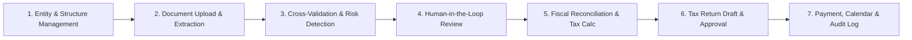

# Nexora — Product Strategy & Concept Specification

> **Product**: Nexora  
> **Category**: Enterprise Corporate Tax Compliance & Intelligent Fraud Prevention (BFSI)  
> **Target Track**: Google Cloud AI Builder Cup — Track 1 BFSI (Smart Risk, Fraud Prevention, Financial Experience)  
> **Document Version**: 1.0 (Phase 1 Baseline)  

---

## 1. Problem Statement

### Who Suffers
Corporate finance leaders, tax directors, and external compliance advisors managing **multi-entity corporate conglomerates** operating across Southeast Asia and global corridors (specifically Indonesia, Singapore, Malaysia, and the United States).

### Frequency & Operational Bottlenecks
- **Monthly**: Invoicing cycles, value-added tax (PPN/GST/SST) reconciliation, withholding tax (PPh 21/23/26, Section 4(2)) calculations, vendor invoice verifications, and e-invoice issuance.
- **Quarterly & Annually**: Corporate income tax (PPh Badan, Form C-S, Form C, Form 1120) fiscal reconciliations, transfer pricing documentation updates, intermediate holding and Ultimate Beneficial Owner (UBO) reporting, and external statutory audit packages.

### The Real Cost of Non-Compliance & Fraud
1. **Financial Penalties & Interest**: Under Indonesian tax regulations (UU KUP / UU HPP), administrative fines range from 20% to 100% on tax underpayments, accompanied by monthly statutory interest charges (tarif bunga KMK).
2. **Faktur Pajak TBTS (Invoices Not Based on Actual Transactions)**: Millions of dollars are lost or caught in frozen tax refunds due to fraudulent or shell vendors, resulting in severe criminal or administrative sanctions under Article 39A UU KUP.
3. **Double Taxation & Transfer Pricing Adjustments**: Cross-border transactions lacking arm's-length documentation or economic substance suffer unilateral tax adjustments and double taxation.
4. **Massive Human Overhead**: Tax specialists spend 70%+ of their working hours manually extracting numbers from scanned PDFs, matching invoices across disparate spreadsheets, and chasing physical document sign-offs across subsidiaries.

---

## 2. Personas & Jobs-to-be-Done (JTBD)

### Persona 1: Group CEO / CFO
- **Profile**: Oversees group governance, shareholder value, consolidated tax expense, and enterprise risk.
- **Jobs-to-be-Done**:
  - *When* reviewing group holding structure across multiple jurisdictions, *I want to* identify high-risk jurisdictions, circular ownership loops, and overall effective tax rate exposure, *so that* I can protect the group's legal standing and investor trust.
  - *When* signing off on annual financial disclosures, *I want to* inspect a high-level executive dashboard showing group-wide pending liabilities and compliance statuses.

### Persona 2: Head of Tax / Group Finance Director
- **Profile**: Responsible for corporate tax filings across all holding entities and operating subsidiaries.
- **Jobs-to-be-Done**:
  - *When* closing the annual fiscal accounts, *I want to* automatically convert commercial profit and loss statements into fiscal net income with positive and negative fiscal adjustments, *so that* my team can generate accurate Corporate Income Tax (SPT 1771 / Form C-S) drafts without weeks of spreadsheet cross-checking.
  - *When* reviewing vendor invoices and input VAT, *I want* real-time fraud alerts flagging mismatched tax IDs, duplicate serial numbers, or anomalous price spikes.

### Persona 3: Senior Tax Consultant / External Advisor
- **Profile**: Advises corporate clients on cross-border transactions, double tax treaties (P3B), and BEPS compliance.
- **Jobs-to-be-Done**:
  - *When* analyzing intermediate holding structures and dividend flows, *I want to* screen intermediary entities for treaty shopping or lack of economic substance, *so that* I can advise on legitimate withholding tax reductions under applicable bilateral tax treaties.
  - *When* consulting on complex tax questions, *I want* a grounded AI Copilot that references official tax codes and OECD guidelines with precise citations instead of hallucinating.

### Persona 4: Internal Auditor / Chief Compliance Officer
- **Profile**: Ensures internal controls, regulatory compliance, maker-checker authorization, and fraud prevention.
- **Jobs-to-be-Done**:
  - *When* auditing tax return submissions, *I want* an unalterable audit log tracing every extracted field, manual override, risk finding review, and manager sign-off, *so that* I can substantiate every figure before statutory authorities.
  - *When* risk flags are raised, *I want to* enforce maker-checker separation so the person who drafted the calculation cannot approve their own submission.

### Persona 5: Compliance Viewer / Read-Only Stakeholder
- **Profile**: Board member or non-tax executive needing transparency without edit permissions.
- **Jobs-to-be-Done**:
  - *When* viewing corporate records, *I want* read-only visibility into tax calendars, payment schedules, and verified entity structures without the risk of accidental modification.

---

## 3. Value Proposition (One-Sentence Anchor)

> **"Nexora membaca dokumen pajak & korporasi, menandai risiko fraud/kepatuhan lengkap dengan bukti, lalu menyiapkan draf rekonsiliasi fiskal yang siap direview manusia."**

*(Nexora extracts corporate and tax documentation, pinpoints fraud and compliance risks backed by inspectable evidence, and automates fiscal reconciliation drafts ready for human-in-the-loop validation.)*

---

## 4. The 7-Stage End-to-End Compliance Cycle (Hero Flow)

1. **Entity & Structure Management**: Manage corporate group directory, establish multi-tiered ownership hierarchies, record intermediate holding entities, and screen for circular ownership or high-risk jurisdictions.
2. **Document Upload & Structured Extraction**: Ingest legal incorporation deeds, tax registration cards (NPWP), audited financial statements, e-Invoices (e-Faktur / InvoiceNow / MyInvois) via Document AI & Gemini Vision.
3. **Cross-Validation & Explainable Risk Detection**: Cross-check extracted values across documents (e.g., deed shareholders vs financial statement disclosures). Trigger dual-layer fraud detection (deterministic rules + statistical anomaly Z-scores / Benford's Law).
4. **Human-in-the-Loop Review**: Present risk findings with specific confidence scores, human-readable explanations, and verifiable evidence clips. Reviewers confirm, comment, or mark false positives.
5. **Fiscal Reconciliation & Calculation**: Transform commercial earnings to taxable income through automated positive and negative fiscal adjustments directly tied to audited findings. Explore What-If scenarios.
6. **Tax Return Draft & Maker-Checker Workflow**: Auto-generate country-specific tax return forms (SPT 1771 for Indonesia, Form C-S for Singapore). Enforce strict separation of duties where creators cannot approve their own work.
7. **Payment, Calendar & Audit Reporting**: Generate e-Billing payment reference codes, schedule statutory deadlines on the Tax Calendar, track payment receipts, and compile unalterable audit trail logs and executive summary packs.

---

## 5. Scope & Country Adapter Prioritization

| Jurisdiction | Scope Level | UI Label | Capabilities Included |
|--------------|-------------|----------|------------------------|
| **Indonesia (ID)** | **Full (P0 Hero Flow)** | `Full Coverage` | Complete corporate lifecycle: SPT 1771, PPh 21/23/26/4(2), PPN 11%, e-Faktur TBTS fraud screening, KUP penalty calculations, e-Billing codes. |
| **Singapore (SG)** | **Adapter (P1)** | `Preview Adapter` | Form C-S corporate draft, 9% GST input/output matching, InvoiceNow UEN validation, MTIC fraud rule checks. |
| **Malaysia (MY)** | **Adapter (P1)** | `Preview Adapter` | Form C draft, 8% SST / e-Invoice MyInvois UUID validation checks, withholding tax rules. |
| **United States (US)** | **Adapter (P1)** | `Preview Adapter` | Form 1120 draft, Federal 21% CIT simulation, TIN validation, Transfer Pricing Section 482 arm's length benchmarking. |

> **Transparency Policy**: Incomplete or secondary country flows are prominently labeled as **"Preview"** in the UI. No fake full submissions or claims of official government API integration will be made.

---

## 6. Explicit Non-Goals

1. **No Live Government e-Filing Submission**: Nexora produces validated, schema-compliant drafts with watermarks (*"DRAF - Bukan untuk disampaikan ke otoritas"*). It does not transmit directly to DJP Online, IRAS, or IRS gateways.
2. **No Final Legal/Tax Opinion**: Nexora is a decision-support, audit-preparation, and risk-intelligence platform. It provides recommendations and citations, but final liability rests with qualified certified tax advisors (Konsultan Pajak Berizin).
3. **No Storage of Live Production PII**: The demo and benchmark suite operates exclusively on realistic synthetic corporate datasets and simulated corporate entities.

---

## 7. Success Metrics & Demonstration Assumptions

*(All metrics represent simulated benchmarks on the standard multi-entity corporate test dataset)*:
- **Reconciliation Time Reduction**: Under 3 minutes for comprehensive fiscal adjustment generation vs. conventional 4-6 hours manual spreadsheet preparation.
- **Anomaly Detection Rate**: 100% capture of injected fraud scenarios (Faktur TBTS, duplicate invoice serial numbers, circular holding, unauthorized price spikes).
- **Extraction Confidence & Manual Touch**: >92% average field extraction confidence on synthetic test documents, with manual correction workflow logging full before/after states.

---

## 8. Core Differentiators

1. **Deep Explainability with Grounded Evidence**: Every risk score (0-100) provides the exact mathematical rationale (e.g., Z-score, mean, standard deviation, rule ID) and cites the exact document snippet.
2. **True Cross-Border Multi-Entity Context**: Intercompany transfer pricing transactions, intermediate foreign shareholders, and cross-border dividend flows are unified into a single group view.
3. **Rigorous Human-in-the-Loop & Maker-Checker**: Automated AI extractions and draft tax returns require distinct human creator and reviewer sign-offs with persistent audit logging.
4. **Integrated 360° Compliance Cycle**: From raw PDF ingestion to structure mapping, fraud detection, fiscal reconciliation, tax return drafting, and tax calendar scheduling in a single cohesive platform.
