# Konsep Produk & Positioning Nexora (Fase 1)

## 1. Value Proposition (Satu Kalimat)
> **"Nexora membaca dokumen pajak & korporasi, menandai risiko fraud/kepatuhan lengkap dengan bukti, lalu menyiapkan draf rekonsiliasi fiskal yang siap direview manusia."**

---

## 2. Problem Statement (Masalah Utama)

### Siapa yang Mengalami Masalah?
Grup korporasi menengah hingga besar di Asia Tenggara (khususnya perusahaan induk di Indonesia dengan entitas anak di Singapura, Malaysia, atau Amerika Serikat), firma konsultan pajak, serta tim audit internal & kepatuhan finansial (BFSI).

### Seberapa Sering Terjadi?
- **Bulanan**: Penutupan masa pajak PPN/e-Faktur, pemotongan PPh unifikasi (PPh 21/23/26/4(2)), dan verifikasi invoice vendor.
- **Kuartalan & Tahunan**: Rekonsiliasi fiskal (book-to-tax adjustment), penyusunan SPT Tahunan PPh Badan (Form 1771 / Form C-S / Form C / Form 1120), serta pengujian kepatuhan struktur kepemilikan & transaksi afiliasi.

### Apa Biayanya jika Tidak Diselesaikan?
1. **Paparan Sanksi & Fraud Faktur**: Di Indonesia, mengkreditkan Faktur Pajak Tidak Berdasarkan Transaksi Sebenarnya (TBTS) atau salah memotong pajak dapat memicu penerbitan SP2DK hingga sanksi administrasi kenaikan 100% sesuai UU KUP.
2. **Koreksi Fiskal yang Terlewat**: Biaya non-deductible (mis. biaya jamuan tanpa daftar nominatif, natura melebihi batas, sanksi pajak) yang tidak dikoreksi positif meningkatkan risiko kurang bayar saat pemeriksaan.
3. **Inefisiensi Rekonsiliasi Manual**: Tim pajak menghabiskan puluhan jam kerja mencocokkan angka antara Akta Pendirian, daftar pemegang saham, laporan keuangan komersial, dan ratusan bukti potong/faktur di spreadsheet yang terpisah tanpa jejak audit (*audit trail*).

---

## 3. Target Pengguna & Jobs-To-Be-Done (JTBD)

| Persona | Peran & Konteks | Jobs-To-Be-Done (JTBD) |
|---|---|---|
| **1. Head of Tax / VP Finance** (Grup Usaha Multi-Entitas) | Bertanggung jawab atas kepatuhan pajak induk di Indonesia dan anak perusahaan regional (SG, MY, US). | *"Ketika masa penutupan pajak tiba, saya ingin melihat postur risiko seluruh entitas grup dalam satu layar, meninjau anomali faktur/kepemilikan yang berdampak material, dan menyetujui draf rekonsiliasi fiskal sebelum dilaporkan."* |
| **2. Tax Consultant / Spesialis Kepatuhan Pajak** | Menyiapkan kertas kerja rekonsiliasi fiskal dan draf SPT klien dari dokumen mentah. | *"Ketika klien mengirimkan bundel dokumen (Akta, Laporan Keuangan, e-Faktur, SPT tahun lalu), saya ingin mengekstrak field penting secara terstruktur, menjalankan validasi silang otomatis, mengedit field yang kurang yakin, dan langsung menurunkan koreksi fiskal positif/negatif beserta dasar aturannya."* |
| **3. Internal Audit & Risk/Compliance Officer (BFSI)** | Mengawasi pencegahan kecurangan pembayaran vendor dan tata kelola grup. | *"Ketika memeriksa transaksi keluar dan struktur grup, saya ingin mendeteksi indikasi split invoicing, vendor fiktif (TBTS/Missing Trader), outlier statistik (Z-score & Benford), serta kepemilikan melingkar lengkap dengan bukti kuantitatif dan jejak audit yang tidak bisa dimanipulasi."* |

---

## 4. Hero Flow (Satu Alur Utama End-to-End)

Nexora memprioritaskan **kedalaman satu alur kerja utama** yang dapat didemokan dari awal hingga akhir dalam 3 menit:

```mermaid
flowchart LR
  S1["1. Muat / Upload Dokumen"] --> S2["2. Ekstraksi Terstruktur & Koreksi"]
  S2 --> S3["3. Validasi Silang & Struktur Kepemilikan"]
  S3 --> S4["4. Temuan Risiko (Rule + Statistik + Bukti)"]
  S4 --> S5["5. Review Manusia (Konfirmasi / False Positive)"]
  S5 --> S6["6. Rekonsiliasi Fiskal & What-If"]
  S6 --> S7["7. Ekspor Draf SPT (JSON/XML/PDF)"]
  S7 --> S8["8. Audit Trail & Copilot Berbasis Sitasi"]
```

1. **Onboarding & Muat Data Contoh / Upload Dokumen**: Satu klik *"Coba dengan data contoh"* langsung memuat grup korporasi lengkap tanpa login dan tanpa API key, atau unggah dokumen baru (PDF/JPG/PNG/JSON/XML).
2. **Ekstraksi Terstruktur (Side-by-Side)**: Dokumen asli di sisi kiri, field hasil ekstraksi beserta skor *confidence* di sisi kanan. Field dengan confidence rendah (< 85%) disorot kuning; koreksi manual langsung tercatat di Audit Log.
3. **Validasi Silang & Struktur Kepemilikan**: Membandingkan konsistensi NPWP/nama/alamat/total dan persentase pemegang saham antar-dokumen (Akta vs Laporan Keuangan vs SPT Sebelumnya) serta memvalidasi grafik kepemilikan (kepemilikan melingkar, total != 100%, UBO belum teridentifikasi, entitas perantara yurisdiksi berisiko).
4. **Temuan Risiko & Fraud (Explainable)**: Setiap temuan memisahkan kontribusi **Skor Aturan Deterministik** dan **Skor Statistik/Model (Z-Score, IQR, Benford)**, lengkap dengan alasan bahasa manusia, bukti spesifik, dan rekomendasi.
5. **Review Manusia (Human-in-the-Loop)**: Reviewer dapat mengubah status temuan (`Baru` -> `Ditinjau` -> `Dikonfirmasi` / `Ditolak`), memberi catatan, atau menekan *"Tandai False Positive"* yang menurunkan bobot aturan serupa pada sesi evaluasi dan tercatat di Audit Log.
6. **Rekonsiliasi Fiskal & Simulator What-If**: Temuan risiko yang dikonfirmasi (mis. biaya jamuan tanpa daftar nominatif atau faktur TBTS) otomatis tertaut ke baris koreksi fiskal positif/negatif. Dilengkapi slider/input *What-If* untuk menguji dampak perubahan asumsi terhadap Pajak Penghasilan Terutang.
7. **Draf SPT & Ekspor**: Menghasilkan draf laporan pajak sesuai adapter negara (SPT 1771 untuk ID; Form C-S, Form C, Form 1120 sebagai Preview) dalam format JSON, XML tervalidasi skema internal, dan ringkasan PDF cetak ber-watermark `"DRAF - BUKAN UNTUK DISAMPAIKAN KE OTORITAS"`.
8. **Audit Log & Copilot Grounded**: Seluruh perubahan field, status review, dan ekspor terekam di tabel Audit Log (dapat diekspor ke CSV). AI Copilot menjawab pertanyaan regulasi **hanya** berdasarkan basis pengetahuan yang di-retrieve (RAG lokal) lengkap dengan sitasi pasal.

---

## 5. Prioritas Cakupan Yurisdiksi

- **🇮🇩 Indonesia (`status: "full"`) — Alur Lengkap End-to-End**:
  - Format identitas: NPWP 15/16 digit & NITKU 22 digit.
  - Dokumen: Akta Pendirian, Daftar Pemegang Saham, Laporan Keuangan, SPT 1771 Sebelumnya, e-Faktur PPN, Bukti Potong e-Bupot PPh 23/21/4(2).
  - Katalog aturan lengkap: Indikasi Faktur TBTS, validitas NPWP/NIK, duplikasi/rentang NSFP, PPN masukan tidak dapat dikreditkan, biaya non-deductible (entertainment tanpa daftar nominatif, natura PMK 66/2023, sanksi pajak), transaksi pihak berelasi tanpa TP Doc, serta aturan statistik lintas negara.
  - Rekonsiliasi fiskal penuh (Pasal 4, Pasal 6, Pasal 9 UU PPh) dan draf SPT Tahunan PPh Badan 1771 + referensi kode e-Billing.
- **🇸🇬 Singapura, 🇲🇾 Malaysia, 🇺🇸 Amerika Serikat (`status: "preview"`) — Country Adapter Berlabel Jujur**:
  - Diimplementasikan melalui kontrak `CountryAdapter` yang sama sehingga menambah atau memperluas negara tidak mengubah kode inti.
  - Diberi badge **`Preview`** secara eksplisit di pemilih negara dan halaman detail.
  - Mencakup validator Tax ID (UEN, LHDN TIN, Federal EIN), skema e-invoice spesifik (InvoiceNow PEPPOL, MyInvois UUID, Form 1099-NEC/W-9), aturan fraud inti per negara (Missing Trader Fraud SG, MyInvois UUID & jendela waktu MY, Backup Withholding US), serta template draf Form C-S / Form C / Form 1120.

---

## 6. Non-Goals (Yang Sengaja TIDAK Dilakukan)

1. **Bukan saluran pelaporan resmi (e-Filing) ke otoritas pajak**: Nexora tidak mengirim data ke DJP Coretax, IRAS, LHDN, atau IRS, dan tidak memproses pembayaran pajak/perbankan nyata.
2. **Bukan pengganti nasihat pajak atau opini hukum final**: Seluruh kalkulasi, skor risiko, dan jawaban Copilot adalah alat bantu keputusan (*decision-support*) yang wajib direview oleh konsultan pajak bersertifikat.
3. **Bukan penyimpanan data produksi wajib pajak nyata pada lingkungan demo**: Lingkungan demo publik hanya ditujukan untuk dataset sintetis/sampel.

---

## 7. Metrik Keberhasilan (Didefinisikan sebagai Asumsi Eksplisit & Target Evaluasi)

> **Catatan Kejujuran**: Angka di bawah ini adalah **asumsi desain & target evaluasi pada dataset sampel**, bukan klaim hasil produksi yang telah diaudit pihak ketiga.

1. **Waktu Rekonsiliasi per Entitas (Asumsi Target Simulasi)**:
   - *Baseline manual*: ~4–6 jam untuk meninjau 10+ dokumen, memvalidasi silang pemegang saham, dan menyusun tabel koreksi fiskal awal.
   - *Target di Nexora (pada dataset sampel)*: < 3 menit dari muat data sampel hingga draf SPT siap diekspor.
2. **Cakupan Deteksi Anomali pada Dataset Sampel**:
   - Menangkap 100% skenario anomali yang disuntikkan secara sengaja pada dataset sampel (mencakup indikasi TBTS, duplikasi NSFP, split invoicing, outlier Z-score, anomali distribusi digit pertama/Benford, biaya non-deductible tanpa daftar nominatif, dan kepemilikan melingkar/belum 100%).
3. **Persentase Field Ekstraksi yang Membutuhkan Koreksi Manual (Simulasi)**:
   - Pada dataset sampel terdiri dari 40+ field ekstraksi, ~10–15% field disimulasikan memiliki *confidence* rendah (< 0.85) agar alur *human-in-the-loop* (sorotan kuning -> koreksi manual -> catat ke audit log) dapat diuji secara nyata.

---

## 8. Diferensiasi vs Alat Pajak / Akuntansi Biasa

| Dimensi | Spreadsheet / Software Akuntansi Standar | Chatbot AI Umum (Un-grounded LLM) | **Nexora (Hybrid Explainable Tax & Risk Platform)** |
|---|---|---|---|
| **Transparansi Skor Risiko (Explainability)** | Tidak ada deteksi fraud otomatis; hanya menjumlahkan angka. | Kotak hitam (*black-box*); rawan mengarang angka & tuduhan. | **Dua Lapisan Terpisah**: Skor Aturan Deterministik + Skor Statistik (Z-Score/IQR/Benford) beserta rumus dan nilai buktinya. |
| **Bukti per Temuan** | Harus mencari file PDF secara manual di folder. | Tidak bisa menunjuk field atau halaman dokumen sumber. | Setiap temuan memuat **tautan ke ID dokumen, halaman/lokasi field, nilai asli, dan parameter statistik**. |
| **Grounding Regulasi** | Statis / manual. | Rawan halusinasi pasal yang sudah dicabut. | **RAG Berbasis Sumber Terverifikasi**: Menolak menjawab jika dasar tidak ditemukan di repositori regulasi; selalu menyertakan sitasi. |
| **Human-in-the-Loop & Audit Trail** | Perubahan sel spreadsheet menimpa nilai lama tanpa catatan siapa & kapan. | Percakapan hilang dan tidak terstruktur. | Koreksi field, konfirmasi temuan, dan penandaan *false positive* tercatat permanen dengan nilai **sebelum vs sesudah** di Audit Log. |
| **Arsitektur Lintas Negara** | Satu aplikasi khusus satu negara. | Pengetahuan umum tanpa skema form. | **CountryAdapter Pattern**: Mendalam di Indonesia (`Full`), siap ekspansi ke SG, MY, US (`Preview`) tanpa mengubah mesin inti. |
