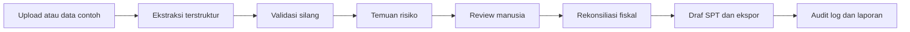

# Nexora - Product Specification v2

> **Fase**: 1, konsep dan positioning
> **Tanggal**: 2026-10-27
> **Status dokumen**: target produk, bukan klaim bahwa semua kemampuan sudah live
> **Dasar audit**: `docs/AUDIT.md`
> **Target submission**: Google Cloud AI Builder Cup, Track 1 BFSI

Dokumen ini menjelaskan produk yang ingin dibangun dan batas kejujurannya. Setiap pernyataan tentang kondisi saat ini merujuk ke `docs/AUDIT.md`. Angka yang belum diukur diberi label **target** atau **asumsi**, bukan hasil.

## Ringkasan Satu Menit

Tim pajak sebuah grup multi-entitas harus mencocokkan akta, daftar pemegang saham, laporan keuangan, faktur, dan SPT dari beberapa negara. Pekerjaan ini berulang, tersebar di spreadsheet, dan sulit diaudit. Nexora membaca dokumen tersebut, mengekstrak field penting, memvalidasi silang, menandai risiko dengan bukti, lalu menyiapkan draf rekonsiliasi fiskal yang harus direview manusia.

Nexora bukan mesin yang memutuskan fraud. Nexora adalah **lapisan bukti dan persiapan review** untuk keputusan yang tetap diambil manusia.

---

## 1. Problem Statement

### 1.1 Siapa yang mengalami masalah

Masalah utama dialami oleh tim pajak dan finance pada grup dengan beberapa entitas hukum di yurisdiksi berbeda. Mereka harus menyatukan data dari sistem akuntansi, dokumen legal, faktur, dan kewajiban pajak lokal. Pekerjaan menjadi lebih sulit ketika entitas memakai mata uang, format nomor pajak, bahasa, dan periode fiskal yang berbeda.

Pengguna utama:

- Head of Tax atau Group Finance Director yang bertanggung jawab atas konsolidasi dan kepatuhan.
- Konsultan pajak yang memeriksa dokumen klien dan menyiapkan kertas kerja.
- Internal audit atau compliance yang membutuhkan jejak keputusan dan bukti.

### 1.2 Seberapa sering

Frekuensi kerja yang menjadi target produk:

- Bulanan: rekonsiliasi PPN/GST/SST, withholding tax, verifikasi faktur, dan pembayaran.
- Kuartalan: review anomali, update dokumentasi transfer pricing, dan persiapan laporan manajemen.
- Tahunan: rekonsiliasi fiskal, draf SPT, review pemegang saham, dan paket audit.

Frekuensi ini adalah **asumsi kerja** berdasarkan proses korporasi pada umumnya. Belum ada wawancara pengguna atau data operasional yang dikumpulkan untuk memvalidasinya.

### 1.3 Apa biayanya

Biaya yang ingin dikurangi:

- Waktu analis untuk mencari, mencocokkan, dan menyalin data dari banyak dokumen.
- Biaya rework ketika angka antar dokumen tidak cocok.
- Risiko sanksi dan sengketa akibat keterlambatan atau kesalahan pelaporan.
- Risiko reputasi dan hubungan vendor ketika temuan fraud salah sasaran.
- Biaya audit internal karena bukti tersebar dan sulit direproduksi.

Belum ada sumber eksternal atau pengukuran biaya yang dilampirkan. Karena itu, besaran waktu, sanksi, dan nilai penghematan dianggap **asumsi yang perlu diverifikasi**. Produk tidak boleh menampilkan angka dampak sebagai fakta sebelum ada baseline dan metode pengukuran.

### 1.4 Mengapa masalah ini cocok untuk AI

Pekerjaan ini memiliki tiga sifat yang cocok untuk bantuan AI:

- Banyak input tidak terstruktur: PDF, hasil scan, XML e-invoice, dan tabel.
- Ada pola yang dapat diperiksa secara deterministik: duplikat, rentang nomor, total saham, dan selisih nilai.
- Keputusan akhir membutuhkan konteks, yurisdiksi, dan pertimbangan manusia.

AI dapat mempercepat ekstraksi dan penyusunan bukti, tetapi tidak boleh menghilangkan review manusia.

---

## 2. Persona

### Persona 1: Head of Tax / Group Finance Director

**Tujuan:** Mengetahui risiko pajak grup lebih awal, menyiapkan rekonsiliasi dan draf SPT dengan lebih sedikit pekerjaan manual, serta dapat menjelaskan angka kepada CFO dan auditor.

**Frustrasi:** Data tersebar di banyak file dan entitas. Tim menghabiskan waktu untuk mencocokkan angka, tetapi sulit menunjukkan dari mana suatu angka berasal. Temuan dari konsultan sering datang tanpa bukti yang cukup untuk ditindaklanjuti.

**Tugas harian:** Meminta status dokumen, meninjau anomali, menetapkan prioritas, mengoreksi asumsi, dan menyetujui langkah berikutnya.

**Keputusan yang dibuat:** Apakah suatu transaksi perlu ditahan, dikoreksi, atau dilaporkan. Apakah draf sudah cukup matang untuk direview ahli. Apakah risiko perlu dieskalasi ke manajemen.

**Bukti yang dibutuhkan agar percaya AI:** Nama aturan, alasan dalam bahasa manusia, nilai dan field yang menjadi dasar, dokumen sumber, tingkat keyakinan, status review, dan jejak siapa mengubah apa.

### Persona 2: Konsultan Pajak

**Tujuan:** Memeriksa dokumen klien lebih cepat, menemukan ketidaksesuaian, dan menyiapkan kertas kerja yang dapat ditelusuri.

**Frustrasi:** Klien mengirim dokumen dengan format dan kualitas berbeda. Pencocokan nama, nomor pajak, periode, dan total sering dilakukan manual. Waktu habis untuk pekerjaan administratif, bukan analisis.

**Tugas harian:** Membaca dokumen, membandingkan data, menandai isu, menulis catatan, dan menyusun rekomendasi.

**Keputusan yang dibuat:** Apakah suatu perbedaan material, apakah perlu klarifikasi ke klien, dan apakah posisi pajak dapat dipertahankan.

**Bukti yang dibutuhkan agar percaya AI:** Kutipan sumber, perbandingan nilai, aturan yang relevan, dan kemampuan menolak menjawab ketika dasar tidak cukup. Konsultan perlu dapat mengubah atau menolak temuan tanpa kehilangan jejak.

### Persona 3: Internal Audit / Compliance

**Tujuan:** Memastikan proses berjalan dengan kontrol yang memadai dan dapat merekonstruksi keputusan.

**Frustrasi:** Temuan tidak memiliki status yang jelas, bukti tersebar, dan perubahan angka tidak tercatat. Sulit membedakan kesalahan data, kelemahan kontrol, dan indikasi fraud.

**Tugas harian:** Meninjau sampel, memeriksa konflik kepentingan, menguji pemisahan tugas, dan meminta bukti tindak lanjut.

**Keputusan yang dibuat:** Apakah suatu temuan perlu investigasi, apakah kontrol perlu diperbaiki, dan apakah suatu tindakan dapat diaudit.

**Bukti yang dibutuhkan agar percaya AI:** Log aksi yang lengkap, alasan perubahan status, reviewer, timestamp, versi data, dan daftar keterbatasan model. Audit tidak boleh bergantung pada klaim "AI sudah memeriksa".

---

## 3. Value Proposition

> **Nexora membaca dokumen pajak dan korporasi, menandai risiko fraud/kepatuhan lengkap dengan bukti, lalu menyiapkan draf rekonsiliasi fiskal yang siap direview manusia.**

### Tiga pembeda

| Pembeda | Arti produk | Bukti yang harus terlihat di UI |
|---|---|---|
| Explainability | Setiap skor dan rekomendasi dapat dijelaskan, bukan kotak hitam | Rule ID, bobot, alasan, nilai statistik, dan asumsi |
| Bukti per temuan | Temuan selalu membawa sumber dan konteks | Dokumen, halaman/field, nilai, pembanding, dan confidence |
| Human-in-the-loop dengan audit trail | Manusia memutuskan dan jejak keputusan tersimpan | Status review, reviewer, catatan, timestamp, dan log aksi |

Produk tidak bersaing dengan ERP atau software pelaporan sebagai sistem pencatatan. Nexora adalah lapisan **document intelligence, risk review, dan audit-ready draft** di antara data mentah dan keputusan manusia.

---

## 4. Hero Flow

### 4.1 Alur target

### 4.2 Kriteria sukses per langkah

| Langkah | Aksi pengguna | Output yang harus ada | Kriteria sukses | Status aktual per audit |
|---|---|---|---|---|
| 1. Upload atau data contoh | Klik satu tombol untuk memuat dataset fiktif | Grup, entitas, dokumen, dan periode termuat | Satu klik, tanpa login dan tanpa API key; data jelas fiktif | Sebagian: auto-load/Reset DB, label demo tidak ada |
| 2. Ekstraksi terstruktur | Buka dokumen atau jalankan ekstraksi | Field, nilai, confidence, dan sumber | Field penting terekstrak; confidence rendah ditandai; koreksi manual tercatat | Mock: timer 750 ms, tidak ada upload file |
| 3. Validasi silang | Jalankan cross-check | Daftar ketidaksesuaian dengan dua sumber | Nama, ID, alamat, periode, dan total dibandingkan; setiap mismatch dapat dibuka | Belum: hanya fungsi test |
| 4. Temuan risiko | Buka daftar temuan | Finding dengan skor, alasan, evidence, confidence, rekomendasi | Setiap finding memiliki rule ID dan bukti; dapat difilter dan diurutkan | Belum: data temuan tidak dirender |
| 5. Review manusia | Ubah status, catatan, atau tandai false positive | Status, reviewer, timestamp, audit entry | Perubahan tersimpan dan dapat diaudit; tidak ada klaim model belajar | Belum: tidak ada workflow review |
| 6. Rekonsiliasi fiskal | Periksa laba komersial dan koreksi | Tabel koreksi positif/negatif dan penghasilan kena pajak | Setiap baris punya dasar dan status verifikasi; koreksi tertaut ke finding | Sebagian: tabel interaktif, data statis, kredit hardcoded |
| 7. Draf SPT dan ekspor | Tinjau draf, unduh JSON/XML/PDF | Draf dengan watermark dan ringkasan | Ekspor tervalidasi skema internal; bukan klaim format resmi | Sebagian: XML/JSON lokal, PDF hanya print, XML belum aman |
| 8. Audit log dan laporan | Filter dan ekspor log | Log aktor, aksi, objek, waktu | Semua aksi penting tercatat; ekspor CSV berfungsi | Mock: hanya log seed, tidak ada penulisan aksi |

### 4.3 Definisi demo-ready

Demo 3 menit dianggap siap jika:

- Dataset fiktif dapat dimuat dengan satu aksi tanpa API key.
- Setidaknya satu finding lengkap dapat dibuka dari data contoh.
- Finding menampilkan skor, confidence, alasan, evidence, rekomendasi, dan status review.
- Reviewer dapat mengubah status dan perubahan itu muncul di audit log.
- Rekonsiliasi menampilkan koreksi yang tertaut ke finding.
- Draf dapat diekspor dengan watermark.
- Copilot menjawab satu pertanyaan dengan sitasi valid dan menolak satu pertanyaan tanpa dasar.
- Badge mode menunjukkan Demo, Live, atau Fallback secara jujur.

---

## 5. Cakupan dan Prioritas Negara

| Yurisdiksi | Level | Yang dicakup | Yang tidak diklaim |
|---|---|---|---|
| Indonesia (ID) | Full | Alur lengkap untuk demo: dokumen, validasi, temuan, rekonsiliasi, draf, review, audit | Bukan pengajuan resmi ke DJP; tarif dan aturan tetap perlu verifikasi ahli |
| Singapura (SG) | Preview | Format UEN, GST, Form C-S, dan contoh risiko terbatas | Tidak semua aturan, tidak pengajuan resmi, tidak menjadi produk SG penuh |
| Malaysia (MY) | Preview | Format TIN, MyInvois, Service Tax, Form C, dan contoh risiko terbatas | Tidak semua aturan, tidak pengajuan resmi |
| Amerika Serikat (US) | Preview | EIN, Form 1120, federal CIT, dan contoh risiko terbatas | Tidak mencakup seluruh aturan negara bagian atau federal |

Aturan cakupan:

- Indonesia adalah jalur yang harus lengkap dan dapat didemokan.
- SG, MY, dan US hanya boleh tampil sebagai **Preview**.
- Menambah negara harus melalui adapter dan tidak mengubah inti alur.
- Label Full dan Preview harus terlihat di UI dan tidak hanya ada di dokumen.
- Semua negara memakai data fiktif untuk demo.
- Tidak ada klaim bahwa perhitungan telah disetujui otoritas pajak.

---

## 6. Non-Goals

Produk ini secara sadar tidak mengejar hal berikut:

1. Mengirim SPT, PPN, GST, atau form apa pun secara resmi ke DJP, IRAS, LHDN, atau IRS.
2. Memberikan opini hukum atau pajak final.
3. Memproses data produksi atau PII nyata pada versi demo.
4. Menggantikan keputusan reviewer, konsultan, atau auditor.
5. Menjatuhkan sanksi atau menuduh vendor melakukan fraud tanpa review manusia.
6. Mengklaim integrasi Google Cloud yang belum benar-benar dipanggil.
7. Melatih model dari tombol false positive sebelum ada data, evaluasi, dan persetujuan.
8. Menyimpan API key di browser atau mengirim key klien ke server.
9. Menjadi sistem akuntansi, ERP, atau sistem pencatatan resmi.
10. Menyajikan skor heuristik sebagai probabilitas fraud yang terkalibrasi.

---

## 7. Metrik Keberhasilan

Semua angka di bawah adalah **target pilot atau asumsi**, bukan hasil pengukuran. Hasil hanya boleh ditulis setelah ada dataset, metode, dan laporan evaluasi.

| Metrik | Definisi | Baseline / target | Cara mengukur | Status |
|---|---|---|---|---|
| Waktu rekonsiliasi per entitas | Waktu dari data siap sampai draf rekonsiliasi selesai | Baseline asumsi 4-6 jam manual; target median <= 60 menit | Stopwatch pada uji tugas dengan pengguna | Belum diukur |
| Anomali tertangkap pada dataset sampel | Recall terhadap ground truth yang ditanam | Target >= 90% untuk 14+ skenario | `npm run eval` dan confusion matrix | Belum ada dataset |
| Presisi temuan | Temuan benar dibagi semua temuan | Target >= 85% pada dataset sampel | Ground truth dan review reviewer | Belum diukur |
| False positive rate | Temuan yang ditolak reviewer dibagi semua temuan | Target <= 15% setelah kalibrasi | Status review dan alasan penolakan | Belum diukur |
| Koreksi field ekstraksi | Persentase field penting yang perlu diubah manusia | Target <= 10% untuk field penting | Exact match dan toleransi terhadap ground truth | Belum diukur |
| Sitasi Copilot valid | Persentase jawaban dengan sitasi yang dapat dibuka dan relevan | Target 100% untuk jawaban yang tidak menolak | Audit sampel jawaban | Belum diukur |
| Refusal rate tanpa dasar | Persentase pertanyaan tanpa dasar yang dijawab menolak | Target >= 90% dari 10 pertanyaan uji tanpa dasar | Set 30 pertanyaan, 10 di antaranya tidak terjawab korpus | Belum diukur |
| Kelengkapan audit | Persentase aksi penting yang memiliki log | Target 100% | Audit log vs daftar aksi | Belum diukur |
| Keberhasilan demo | Jumlah langkah kritis yang gagal dalam 3 menit | Target 0 kegagalan kritis dalam 3 dry run | Checklist demo | Belum diuji |

Metrik north star yang diusulkan: **persentase temuan yang diterima reviewer dengan bukti lengkap**. Metrik ini lebih bermakna daripada jumlah temuan, karena temuan yang tidak dapat ditindaklanjuti bukan nilai.

---

## 8. Pemetaan ke Kriteria Track 1 BFSI

Pemetaan ini memakai tiga area yang disebut dalam brief: risiko cerdas, pencegahan penipuan, dan pengalaman keuangan. Detail kriteria resmi tetap perlu dicek pada brief terbaru.

| Fitur Nexora | Area Track 1 | Masalah yang dijawab | Bukti demo |
|---|---|---|---|
| Struktur kepemilikan dan validasi 100% | Risiko cerdas | Risiko tata kelola dan pemilik manfaat tidak jelas | Graph, total saham, mismatch akta vs laporan |
| Cross-document validation | Risiko cerdas | Data antar dokumen tidak konsisten | Dua nilai, dua sumber, selisih |
| Risk scoring dan rule catalog | Risiko cerdas | Prioritas review tidak jelas | Skor, rule, alasan, confidence |
| Duplikat, split invoice, outlier, Benford | Pencegahan penipuan | Pola fraud sulit ditemukan manual | Finding dan evidence statistik |
| Validasi tax ID dan yurisdiksi | Pencegahan penipuan | Vendor/tujuan berisiko | Format ID, negara, status verifikasi |
| Human review dan audit trail | Kepercayaan dan tata kelola | Keputusan AI tidak dapat dipertanggungjawabkan | Status, reviewer, log |
| Rekonsiliasi fiskal | Pengalaman keuangan | Proses koreksi lambat dan tersebar | Tabel koreksi dan dampak |
| Copilot bersitasi | Pengalaman keuangan | Mencari dasar aturan memakan waktu | Jawaban, sitasi, penolakan |
| Draf dan ekspor | Pengalaman keuangan | Kertas kerja tidak konsisten | JSON/XML/PDF draft dengan watermark |
| Country adapter | Skala dan pengalaman | Aturan berbeda per negara | ID full, SG/MY/US preview |

---

## 9. Responsible AI

### 9.1 Batasan

- Ekstraksi dokumen dapat salah karena scan buruk, field hilang, bahasa, atau format tidak standar.
- Aturan dan tarif pajak dapat berubah. Setiap referensi harus memiliki sumber, tanggal akses, versi, dan label "perlu verifikasi" bila belum diperiksa ahli.
- Skor risiko adalah heuristik untuk prioritisasi. Skor bukan bukti fraud dan bukan probabilitas yang terkalibrasi sampai ada evaluasi.
- Cakupan SG, MY, dan US adalah preview. Ketidaklengkapan harus terlihat, bukan disembunyikan.
- Model bahasa dapat menghasilkan jawaban yang terdengar benar. Karena itu Copilot harus menolak jika dasar tidak cukup.
- Data demo adalah fiktif dan tidak boleh dicampur dengan data produksi.

### 9.2 Bias yang mungkin

- Data Indonesia lebih lengkap, sehingga model atau aturan bisa tampak lebih akurat untuk Indonesia.
- Vendor kecil, vendor baru, atau vendor dengan format dokumen tidak umum dapat lebih sering ditandai.
- Ambang nilai dan pola historis dapat menghukum entitas yang memang baru atau sedang tumbuh.
- Bahasa dan format dokumen dapat memengaruhi kualitas ekstraksi.
- Rule yang diturunkan dari satu grup dapat tidak cocok untuk industri lain.

Mitigasi: tampilkan coverage, confidence, dan keterbatasan; uji dengan kasus normal yang mirip anomali; ukur false positive per segmen; jangan memakai skor sebagai satu-satunya dasar tindakan.

### 9.3 False positive

False positive adalah risiko utama karena dapat merugikan vendor yang tidak bersalah. Produk harus:

- Menampilkan alasan dan bukti yang dapat diperiksa.
- Menyediakan status `Ditolak` dengan catatan.
- Mencatat false positive sebagai umpan balik kalibrasi, bukan klaim bahwa model sudah belajar.
- Menghindari tindakan otomatis seperti memblokir pembayaran tanpa review.
- Menyebutkan bahwa ambang belum dikalibrasi sampai evaluasi selesai.

### 9.4 Kapan manusia wajib memutuskan

Manusia wajib memutuskan pada:

- Konfirmasi atau penolakan finding.
- Penentuan perlakuan pajak dan koreksi fiskal.
- Persetujuan draf SPT atau dokumen yang akan disampaikan.
- Komunikasi dengan vendor atau pihak berelasi.
- Eskalasi ke investigasi, hukum, atau manajemen.
- Perubahan ambang, aturan, atau asumsi skor.

### 9.5 Data, privasi, dan prompt injection

- Semua panggilan AI dilakukan di server.
- API key tidak boleh berada di bundle klien.
- Data sensitif dimasking di UI dan log.
- Isi dokumen diperlakukan sebagai data, bukan instruksi.
- Instruksi tersembunyi dalam dokumen harus ditolak dan dicatat.
- Demo hanya memakai data fiktif.
- Retensi dan penghapusan data harus didefinisikan sebelum pilot.

---

## 10. Prinsip Produk

1. **Evidence first:** tidak ada temuan tanpa sumber dan alasan.
2. **Human authority:** AI menyiapkan, manusia memutuskan.
3. **Honest status:** setiap kemampuan diberi label Live, Simulasi, Preview, Rencana, atau Belum.
4. **Deterministic first:** aturan yang dapat dihitung tidak perlu dipaksa menjadi model generatif.
5. **Least data:** kumpulkan dan tampilkan data seminimal mungkin.
6. **Audit by default:** aksi penting harus meninggalkan jejak.
7. **Country adapter:** aturan negara tidak boleh mengotori inti alur.
8. **No silent failure:** fallback dan error harus terlihat oleh pengguna.
9. **No fake precision:** confidence dan skor harus punya dasar atau diberi label heuristik.
10. **Demo is a promise:** jika tidak dapat didemokan, jangan diklaim sebagai fitur live.

---

## 11. Kondisi Saat Ini dan Gap

Bagian ini penting agar tim tidak membangun narasi di atas kemampuan yang belum ada.

| Kemampuan target | Kondisi per 2026-10-27 | Gap utama |
|---|---|---|
| Satu klik data contoh | Auto-load dan Reset DB | Tidak ada label demo yang jelas; data tidak konsisten |
| Upload dan ekstraksi | Timer mock | Tidak ada file input, storage, atau Document AI |
| Validasi silang | Logika test | Tidak dipanggil UI |
| Findings dan review | Tidak ada | Tidak ada model, layar, API, atau audit |
| Rekonsiliasi | UI interaktif | Data statis, kredit hardcoded, tidak tertaut finding |
| Draf SPT | UI dan export lokal | Angka tidak tersambung; XML tidak aman dan tidak resmi |
| Copilot | Gemini kondisional dan fallback statis | Tidak ada RAG, sitasi dapat diverifikasi, atau badge mode |
| Audit trail | Log seed | Tidak ada penulisan aksi dan tidak immutable |
| Google Cloud | Gemini kondisional | Document AI, BigQuery, Vertex AI tidak dipanggil |
| Evaluasi | Belum ada | Tidak ada ground truth atau `npm run eval` |

Untuk daftar bukti dan tingkat keparahan, lihat `docs/AUDIT.md`. Fase berikutnya harus menutup gap pada urutan yang mendukung hero flow, bukan menambah permukaan fitur baru.

---

## 12. Asumsi dan Pertanyaan Terbuka

### 12.1 Register asumsi

| ID | Asumsi | Status |
|---|---|---|
| A-01 | Tim pajak grup menghabiskan beberapa jam per entitas untuk rekonsiliasi manual | Asumsi, belum diukur |
| A-02 | Reviewer lebih percaya temuan jika ada sumber dan alasan | Asumsi desain, perlu uji pengguna |
| A-03 | Indonesia adalah pasar pertama yang paling masuk akal untuk demo | Keputusan produk, perlu validasi pasar |
| A-04 | Data fiktif cukup untuk menunjukkan nilai tanpa data produksi | Asumsi demo |
| A-05 | False positive lebih merugikan daripada false negative dalam konteks vendor | Asumsi risiko, perlu kebijakan |
| A-06 | Pengguna menerima AI sebagai alat bantu, bukan pengganti keputusan | Asumsi adopsi |
| A-07 | SG/MY/US dapat ditampilkan sebagai preview tanpa merusak kredibilitas | Keputusan cakupan, perlu label UI |
| A-08 | Target metrik di Bagian 7 dapat dicapai dalam pilot | Target, belum diukur |
| A-09 | Data demo tidak boleh mengandung PII nyata | Kebijakan wajib |
| A-10 | Skor heuristik cukup untuk prioritisasi awal | Asumsi, harus diuji di EVAL |

### 12.2 Pertanyaan yang harus dijawab sebelum pilot

- Siapa design partner pertama dan apakah mereka bersedia menyediakan data fiktif yang realistis?
- Apakah pengguna menginginkan review per finding atau per dokumen?
- Berapa lama retensi dokumen dan log yang dapat diterima?
- Apakah SG/MY/US cukup sebagai preview, atau salah satu perlu dinaikkan ke full?
- Apakah harga akan berbasis entitas, dokumen, atau kursi reviewer?
- Siapa yang bertanggung jawab atas keputusan akhir dan bagaimana hal itu dicatat?
- Apakah evaluasi akan memakai reviewer manusia sebagai ground truth atau aturan yang ditanam?

---

## 13. Keputusan Produk untuk Fase 2

Keputusan berikut perlu dicatat secara formal di `docs/DECISIONS.md` saat arsitektur dibuat:

1. Indonesia menjadi jalur full; SG, MY, dan US tetap preview.
2. Hero flow dioptimalkan untuk satu alur utama, bukan lebar fitur.
3. Temuan wajib memiliki evidence dan status review.
4. Skor risiko adalah heuristik yang dapat dikonfigurasi, bukan model fraud terkalibrasi.
5. Demo memakai mesin deterministik dan data fiktif; live AI bersifat opsional dan harus fallback secara transparan.
6. Dokumen adalah data, bukan instruksi.
7. Semua klaim integrasi mengikuti label Live, Simulasi, Preview, Rencana, atau Belum.

---

## 14. Ukuran Keberhasilan Dokumen Ini

Dokumen ini dianggap berhasil jika:

- Orang non-teknis dapat menjelaskan masalah, pengguna, nilai, dan batas produk setelah membaca sekali.
- Setiap klaim ambisi memiliki label target atau asumsi.
- Tidak ada klaim integrasi yang bertentangan dengan `docs/AUDIT.md`.
- Hero flow memiliki kriteria sukses yang dapat diuji.
- Tim dapat memakai dokumen ini untuk menolak fitur yang tidak mendukung alur utama.
